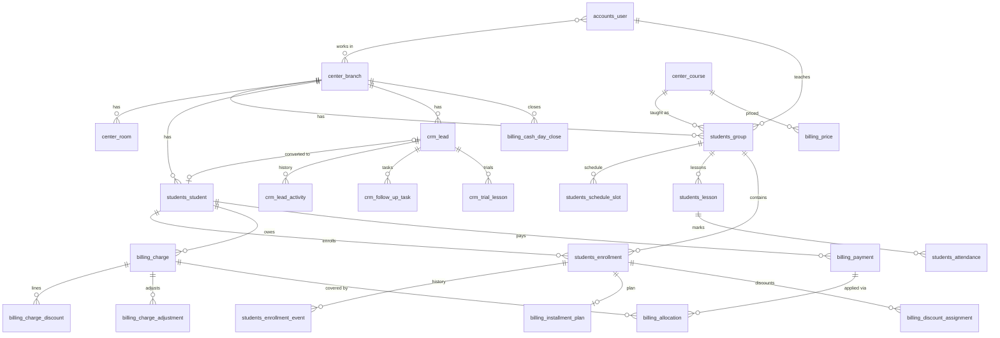

# Matematika Markazi — Operations Platform

## Module 1 specification: CRM, students, payment control

Status: **Approved** (all section 9 recommendations accepted). The data model in section 5 is frozen; changes need the owner's explicit approval (see CLAUDE.md). Implementation notes per phase are in section 12.

Language: this document is in English for developers. Everything a user sees is in Uzbek, Latin script.

---

## 1. Scope

### 1.1 In scope (module 1)

| Area | Uzbek UI name | Contents |
|---|---|---|
| CRM | Lidlar | Lead cards, pipeline board, duplicate warning, follow-up tasks, trial lessons, conversion to student |
| Students and groups | O'quvchilar, Guruhlar | Profiles, groups, weekly schedule, enroll / move / freeze / leave, Excel import |
| Attendance | Davomat | Present or absent per lesson. Informational only, no effect on billing |
| Billing | To'lovlar, Qarzdorlik, Kassa | Charge ledger, monthly charges, installment plans, discounts, payments, receipts, reversals, debtors, daily cash close |
| Reports | Hisobotlar | Director and branch dashboards, Excel export |
| Settings | Sozlamalar | Every business setting, editable by the director |
| Audit | Harakatlar jurnali | Every financial action and settings change, with before and after values |

### 1.2 Out of scope (module 1)

Online payments (Click, Payme, Uzum), Telegram bot, SMS, teacher salaries, LMS and homework, native mobile apps, Instagram and Telegram API integrations. Section 4 defines the extension points these modules will plug into.

---

## 2. Stack and why

| Layer | Choice | Why |
|---|---|---|
| Language | **Python 3.12** | Mainstream, large hiring pool in Uzbekistan, and the most common Telegram bot library locally (aiogram) is Python, so the future bot can share models and code with this system. |
| Web framework | **Django 5.2 LTS** | LTS with security support until April 2028. It ships everything this module needs: authentication, sessions, CSRF protection, ORM with migrations, forms with validation, gettext i18n with plural forms, and timezone support. Fewer third-party pieces means fewer things to break over the years. A Django "app" maps naturally onto a business module. |
| Database | **PostgreSQL 17** | Required by the brief. Used for `bigint` money columns, CHECK constraints, row locks (`SELECT … FOR UPDATE`) for receipt numbers and allocation, `jsonb` for audit snapshots, and triggers that block UPDATE/DELETE on ledger tables. |
| UI | **Server-rendered Django templates + HTMX 2 + Alpine.js 3 + Tailwind CSS 4** | One codebase, no separate SPA and API to keep in sync. HTMX handles partial updates (pipeline moves, attendance toggles, payment forms) without a JavaScript build. Tailwind makes the mobile-first layout straightforward. The Tailwind standalone CLI runs only in the Docker build stage, so the runtime needs no Node.js. |
| Drag and drop | SortableJS | Pipeline board on desktop. On phones the board becomes a tabbed list with a "move to stage" menu, because dragging on small screens is unreliable. |
| Excel | **openpyxl** | Reads the import files and writes the report exports. |
| Receipts | HTML print view (80 mm thermal and A5 layouts) | No PDF library needed. The browser's print dialog handles printing, and "save as PDF" works on every phone. |
| Background jobs | Django management commands run by **supercronic** in a `cron` container | Module 1 only needs scheduled jobs (monthly charges, lesson generation, backups). Celery and Redis would add two services with no benefit yet. Every job is idempotent, so a missed or repeated run is safe. Celery can be added later if online payments need queues. |
| App server | gunicorn | Standard. |
| Reverse proxy / TLS | **Caddy 2** | Automatic free Let's Encrypt certificates with a five-line config. |
| Packaging | **uv** with `pyproject.toml` and `uv.lock` | Fast, reproducible installs. Now mainstream. |
| Tests | **pytest + pytest-django + factory_boy** | Standard. Billing math lives in pure functions that are tested without a database, plus integration tests against a real PostgreSQL. |
| Module boundaries | **import-linter** | Enforces the dependency rules in section 4.2 in CI, so boundaries don't erode. |
| Deployment | Docker Compose on a single Linux VPS | As required. |

**Alternatives I rejected:**
- **Next.js + NestJS + Prisma.** This means two codebases and an API contract between them. You have to build auth, i18n, form validation and migrations from several libraries yourself. That's more surface area for a small team, with no gain for a back-office app.
- **Laravel.** A good fit, roughly equal to Django. Django wins here on the Python ecosystem (Excel, reporting, the aiogram Telegram bot) and on built-in gettext i18n.
- **React SPA + Django REST Framework.** Not needed for module 1. Because every write goes through a service layer (section 4.3), a DRF API for a future mobile app or Telegram bot can be added on top of the same services without touching business logic.

No paid services and no external APIs are used.

---

## 3. Global conventions (summary; CLAUDE.md is the binding version)

- **Money:** whole UZS (so'm) as `bigint`. Never floats or decimals. Shown as `1 250 000 so'm` with a narrow no-break space (U+202F) as the thousands separator.
- **Dates:** business dates are PostgreSQL `date` columns, computed in Asia/Tashkent. Timestamps are `timestamptz`, stored in UTC and shown in Tashkent time. Dates display as `DD.MM.YYYY` and date-times as `DD.MM.YYYY HH:MM`. Code never calls `date.today()` and always calls `core.dates.today()`.
- **Phones:** stored in E.164 form, `+998XXXXXXXXX` (12 digits after the `+`). Input accepts `90 123 45 67`, `+998 (90) 123-45-67`, `998901234567` and similar, and normalizes them. Displayed as `+998 90 123 45 67`.
- **Text:** every UI string goes through gettext (`` / `gettext_lazy`). Default and only active language in module 1: `uz` (Latin). The layout is ready for `ru` and `uz-cyrl`. The apostrophe in o', g' and the tutuq belgisi is the ASCII `'`, matching the brief and how staff type on phones. Search treats `'`, `‘`, `’`, `ʻ` and `ʼ` as the same character.
- **Center name:** "Matematika Markazi". It appears in the layout header, the login page and receipts, and is editable in Sozlamalar.

---

## 4. Architecture

### 4.1 Shape

A **modular monolith**: one Django project, one PostgreSQL database, one deployable image. Each business area is a Django app with a public interface and private internals. This is the simplest shape that still keeps clear boundaries. A module can later be extracted into a service if that ever becomes necessary, but nothing in module 1 calls for it.

```
config/                  Django project: settings (base/dev/prod/test), root urls, wsgi
apps/
  core/                  shared kernel: money, phone, dates, i18n formatting, audit log,
                         event bus + outbox, permission framework, registries, UI shell
  accounts/              users, roles, branch membership, login
  settings/              (app label: center_settings) branches, rooms, courses, center
                         info + the Sozlamalar panel shell
  crm/                   leads, pipeline, follow-up tasks, trial lessons; owns lead
                         sources, stages, refusal reasons
  students/              students, groups, schedule, lessons, enrollments, attendance,
                         Excel import
  billing/               prices, installment templates, discount types, payment methods
                         and providers, charges, payments, allocations, receipts, cash close
  reports/               dashboards, report tables, Excel export (read-only)
templates/               base layout and shared components
static/                  Tailwind source, built CSS, vendored htmx/alpine/sortable
locale/uz/LC_MESSAGES/   django.po (all UI text)
scripts/                 backup.sh, restore.sh, entrypoint.sh
docs/                    SPEC.md, module notes
tests/                   cross-module tests: role/branch permission matrix, i18n checks
```

### 4.2 Dependency rules (enforced by import-linter)

```
core  ←  accounts  ←  settings  ←  crm
                              ←  students  ←  billing  ←  reports
                                      ↑
                                     crm (converts a lead into a student)
```

- A module may import from a module to its left/below in this graph, never the other way.
- A module imports only another module's **public interface**: `services`, `selectors`, `events`, and `models` (only for ForeignKey targets and type hints). It never imports another module's views, forms or internal helpers.
- When a lower module must trigger behavior in a higher one, it publishes a **domain event**, and the higher module subscribes. Example: `students` publishes `EnrollmentCreated`, and `billing` reacts by creating charges. `students` never imports `billing`.
- `reports` is read-only. It may read any module's selectors, or run SQL over their tables, but never writes.

### 4.3 Inside a module

```
apps/billing/
  models.py            tables (Django models)
  domain/              pure functions, no Django or DB imports:
                       proration.py, allocation.py, installments.py, discounts.py, rounding.py
  services/            the ONLY place that writes. Each service function: checks
                       permission, opens a transaction, takes locks, validates, writes,
                       writes audit rows, publishes events
  selectors.py         read queries. Every selector takes the acting user and applies
                       role and branch scoping
  policies.py          permission rules for this module (who may do what, in which branch)
  events.py            event classes this module publishes
  handlers.py          subscriptions to other modules' events
  providers/           (billing only) payment provider interface + manual provider
  registry.py          registrations: nav items, settings sections, dashboard widgets,
                       reports, enrollment extensions
  views.py, urls.py, forms.py, templates/billing/
  management/commands/ scheduled jobs
  tests/
```

Views are thin: they parse input, call one service or selector, and render. Business rules never live in views or templates.

### 4.4 Extension points (how future modules plug in)

All registries live in `apps/core/registry.py`. A module registers itself in its `AppConfig.ready()`.

| Extension point | Used in module 1 by | Future use |
|---|---|---|
| **Navigation registry**: menu items with required permission, icon, mobile priority | every module | Schedule, Salaries, LMS add menu items |
| **Settings section registry**: pages in Sozlamalar | settings, crm, billing, accounts | Salary rates, Telegram bot config |
| **Dashboard widget registry**: cards per role | reports, crm, billing | Teacher salary summary |
| **Report registry**: report definitions (columns, filters, scoping, export) | reports | Any module's reports, with free Excel export |
| **Permission registry**: named permissions + role defaults | every module | New modules declare their permissions |
| **Domain event bus**: synchronous in-transaction handlers + **outbox table** for asynchronous consumers | students → billing; billing/crm → outbox | Telegram notifications read the outbox ("payment received", "debt overdue", "trial lesson tomorrow") |
| **Enrollment extensions**: a module can add a step to the enrollment form and react on commit | billing (proration suggestion, discount, installment schedule) | Salaries (teacher rate per student) |
| **Payment provider interface** (`billing/providers/base.py`) | `ManualProvider` (cash, terminal, bank transfer) | `ClickProvider`, `PaymeProvider`, `UzumProvider`: create invoice, verify webhook, confirm payment. Payment table already has `provider_code`, `external_id`, `status` |

**Payment provider contract (designed now, only the manual provider is built):**

```python
class PaymentProvider(Protocol):
    code: str                      # "manual", later "click", "payme", "uzum"
    is_online: bool                # manual: False
    def validate_manual_entry(self, data) -> None: ...      # manual only
    def create_invoice(self, student, amount, ...) -> Invoice: ...   # online only
    def handle_webhook(self, request) -> ProviderResult: ...         # online only
```

Online payments will arrive as `payment` rows with `status=pending`. They become `confirmed` after webhook verification, with `received_by` set to a system user. The allocation, receipt and reporting code is the same for every provider. Each payment method has an `included_in_cash_close` flag. Manual methods have it on. Online methods will have it off, because nobody hands that money to a cashier, so it is reconciled against provider statements instead of the daily close.

### 4.5 Security and scoping (server-side)

- Every view declares a required permission (decorator or mixin). The permission check runs in the **service or selector**, not only in the view, so a future API or Telegram bot can't bypass it.
- Every selector starts from `scoped_queryset(model, user)`:
  - Direktor: all branches.
  - Filial administratori and Sotuv menejeri: `branch_id IN user.branch_ids`.
  - O'qituvchi: rows reachable through groups where `teacher_id = user.id`.
- An object outside the user's scope returns **404**, not 403, so its existence doesn't leak.
- Financial fields are removed at the selector level for roles without finance permission. Sotuv menejeri gets only a derived `payment_status` (see 6.4.10), never amounts. O'qituvchi gets no financial fields at all.
- CSRF on all forms. Session cookies are `Secure`, `HttpOnly` and `SameSite=Lax`. Passwords use Django's PBKDF2. Logins are rate-limited per phone and IP (in the database, no Redis). The session timeout is 12 hours and is configurable.
- Django admin is **disabled in production** (it is English and bypasses the policies). It is available in development only.
- A permission matrix test (`tests/test_permission_matrix.py`) calls every URL as every role, from inside and outside the branch, and asserts the expected status. Every new endpoint must be added to it, and CI fails on an unlisted URL.

### 4.6 Audit log

- `core.audit.record(actor, action, obj, before, after, branch)` is called inside the same transaction as the change, from services only.
- It records: every financial write (charge, discount, adjustment, payment, reversal, refund, installment edit, cash close, opening balance import), every settings change, user and role changes, enrollment lifecycle actions, and logins (both successful and failed).
- `before` and `after` are JSON snapshots of the changed fields. Money is stored as integers.
- The audit table is append-only: a PostgreSQL trigger rejects UPDATE and DELETE.
- Only the Direktor can view it. It is filterable by user, branch, entity type, action and date, and exportable to Excel.

### 4.7 Append-only ledger enforcement

The tables `billing_charge`, `billing_charge_discount`, `billing_charge_adjustment`, `billing_payment`, `billing_cash_day_close` and `core_audit_log` carry a trigger that raises an exception on UPDATE or DELETE. The only exceptions are columns that are explicitly mutable, such as the payment `status` transition `pending → confirmed` reserved for future online providers. A bug in application code therefore can't silently rewrite money history. `billing_allocation` is not money history. It is a derived cache (section 6.4.6) and can be rebuilt at any time.

---

## 5. Data model

Conventions: every table has `id bigint` (identity), `created_at timestamptz`, and where relevant `created_by → accounts_user`. Money is `bigint` with `CHECK (>= 0)` unless a column is stated as signed. "Ref" tables (configurable lists) have `name`, `sort_order`, `is_active`. Rows referenced by other rows are deactivated, never deleted.

### 5.1 core

| Table | Columns | Notes |
|---|---|---|
| `core_audit_log` | actor_id, action (e.g. `billing.payment.create`), entity_type, entity_id, branch_id null, before jsonb, after jsonb, reason text null, ip, user_agent, created_at | Append-only |
| `core_outbox_event` | event_type, payload jsonb, occurred_at, processed_at null, attempts, last_error | Written in the same transaction as the change. Module 1 writes events but has no consumers yet |
| `core_system_setting` | key (unique), value jsonb, updated_by, updated_at | Typed settings, e.g. `billing.rounding_step`, `billing.monthly_due_day`. Every change is audited |

### 5.2 accounts

| Table | Columns | Notes |
|---|---|---|
| `accounts_user` | phone (unique, login), full_name, password, role (`director` \| `branch_admin` \| `sales_manager` \| `teacher`), is_active, must_change_password, last_login | One role per user |
| `accounts_user_branch` | user_id, branch_id (unique pair) | Director: none needed (all). Admin and manager: usually one. Teacher: one or more |

### 5.3 settings (app label `center_settings`)

| Table | Columns | Notes |
|---|---|---|
| `center_branch` | name, address, phone, receipt_prefix (e.g. `CH`), is_active | |
| `center_room` | branch_id, name, capacity, is_active | |
| `center_course` | name, pricing_model (`monthly` \| `installment`), duration_months null, description, is_active | Pricing model is fixed once a group of the course exists |
| `center_info` | single row: center_name ("Matematika Markazi"), legal_name, inn (STIR), bank details, phone, receipt_footer | Receipt details. Can be overridden per branch via `center_branch_receipt_info` |
| `center_branch_receipt_info` | branch_id (unique), legal_name, inn, address, phone, footer | Optional override |

### 5.4 crm

| Table | Columns | Notes |
|---|---|---|
| `crm_lead_source` | ref | Instagram, Telegram, Telefon qo'ng'irog'i, O'zi kelgan, Tavsiya |
| `crm_lead_stage` | ref + kind (`new` \| `contacted` \| `trial_booked` \| `trial_attended` \| `won` \| `lost` \| `custom`), color | The 6 system stages can be renamed and reordered but not deleted. The director may add `custom` stages between them |
| `crm_refusal_reason` | ref | |
| `crm_lead` | branch_id, full_name, phone, phone_normalized (indexed), extra_phone null, source_id, course_id null (interest), manager_id null, stage_id, refusal_reason_id null, refusal_note, notes, next_follow_up_at null (denormalized from tasks), student_id null (set on conversion), converted_at null | |
| `crm_lead_activity` | lead_id, kind (`note` \| `call` \| `stage_change` \| `trial` \| `task` \| `converted` \| `edit`), text, from_stage_id, to_stage_id, created_by, created_at | Full lead history. Kept forever, also after conversion |
| `crm_follow_up_task` | lead_id, assigned_to_id, due_at timestamptz, title, done_at null, done_by_id null | Overdue = `done_at IS NULL AND due_at < now()` |
| `crm_trial_lesson` | lead_id, group_id, lesson_id null, scheduled_date, status (`booked` \| `attended` \| `no_show` \| `cancelled`), note | Trial lessons are free (no charge) |

### 5.5 students

| Table | Columns | Notes |
|---|---|---|
| `students_student` | branch_id, first_name, last_name, middle_name null, birth_date null, phone null, parent_name, parent_phone null, extra_phone null, notes, lead_id null, import_batch_id null | At least one of phone / parent_phone is required. Both are normalized and indexed for duplicate search. Status is derived from enrollments |
| `students_group` | branch_id, course_id, teacher_id, room_id null, name, start_date, end_date null, capacity, status (`planned` \| `active` \| `finished`), default_installment_template_id null, import_batch_id null | |
| `students_schedule_slot` | group_id, weekday (1=Mon…7=Sun), start_time, end_time, room_id null | Weekly schedule |
| `students_lesson` | group_id, date, start_time, end_time, room_id, status (`scheduled` \| `held` \| `cancelled`), cancel_reason | Materialized from slots: whole group duration, or rolling 3 months if no end date. Regenerated for future dates when the schedule changes. Lessons with attendance are never deleted. **Proration counts these rows** |
| `students_enrollment` | student_id, group_id, start_date, end_date null, status (`active` \| `frozen` \| `left` \| `moved` \| `completed`), import_batch_id null | Unique active enrollment per (student, group) |
| `students_enrollment_event` | enrollment_id, kind (`enrolled` \| `frozen` \| `unfrozen` \| `moved_out` \| `moved_in` \| `left` \| `completed`), effective_date, reason (required except `enrolled`/`completed`), related_enrollment_id null (move pair), created_by, created_at | Every lifecycle action with date and reason |
| `students_freeze` | enrollment_id, from_date, to_date null, reason | Open freeze = `to_date IS NULL` |
| `students_attendance` | lesson_id, enrollment_id, student_id, status (`present` \| `absent`), marked_by, marked_at | Unique (lesson, student). Edits are audited (not financial, but cheap to keep) |
| `students_import_batch` | kind (`groups` \| `students` \| `opening_balances`), file_name, file (stored), uploaded_by, status (`validated` \| `committed` \| `failed`), row_count, report jsonb | Every imported row points back to its batch |

### 5.6 billing

**Configuration (editable in Sozlamalar)**

| Table | Columns | Notes |
|---|---|---|
| `billing_price` | course_id, branch_id null, group_id null, kind (`monthly` \| `full_course`), amount, effective_from date, note, created_by, created_at | **Immutable.** A price change is a new row. Resolution for (group, date): most specific scope wins (group > branch > course), then latest `effective_from <= date`, then latest `created_at`. This table *is* the price history |
| `billing_installment_template` | course_id null, name, parts_count, split_mode (`equal` \| `custom`), first_due (`on_start` \| `fixed_day`), interval_months (default 1), due_day_of_month null, is_active | Due-date rule: part 1 is due on the start date (or the next `due_day_of_month`), and each next part is `interval_months` later, on `due_day_of_month` if set |
| `billing_installment_template_part` | template_id, part_no, share_bp (basis points, sum = 10000) | Only for `custom` split |
| `billing_discount_type` | name, kind (`percent` \| `fixed`), value (percent in basis points, or so'm), applies_to (`monthly` \| `installment` \| `any`), allow_custom_value bool, is_active | E.g. "Aka-uka chegirmasi 10%", "Promo 50 000 so'm" |
| `billing_payment_method` | name, provider_code (`manual` now), included_in_cash_close bool, is_active, sort_order | Seed: Naqd, Terminal (karta), Bank o'tkazmasi |

**Assignments and plans**

| Table | Columns | Notes |
|---|---|---|
| `billing_discount_assignment` | enrollment_id, discount_type_id, value (snapshot or custom), valid_from, valid_to null, reason, created_by, ended_by null, ended_at null | Ending one sets `valid_to` (audited). Never affects charges already issued |
| `billing_installment_plan` | enrollment_id (unique), template_id null, template_snapshot jsonb, full_price, price_id, created_by | One per enrollment in an installment course |
| `billing_installment_plan_revision` | plan_id, reason, before jsonb, after jsonb, created_by, created_at | Every schedule edit |

**Ledger (append-only)**

| Table | Columns | Notes |
|---|---|---|
| `billing_charge` (hisoblangan) | student_id, branch_id, enrollment_id null, group_id null, course_id null, kind (`monthly` \| `installment` \| `opening_balance` \| `manual`), period_month date null (1st of month, monthly only), plan_id null, part_no null, due_date, base_amount (price snapshot), suggested_amount null, amount (before discounts), override_reason null, price_id null, description, import_batch_id null, created_by, created_at | `CHECK (amount <> suggested_amount ⇒ override_reason IS NOT NULL)`. Unique (enrollment_id, period_month) where kind=monthly, so the monthly job can't double-charge |
| `billing_charge_discount` | charge_id, assignment_id, discount_type_id, name_snapshot, kind, value, amount | A separate line under the charge |
| `billing_charge_adjustment` | charge_id, amount **signed** (usually negative), kind (`proration_leave` \| `proration_freeze` \| `plan_edit` \| `cancellation` \| `correction`), suggested_amount null, reason, created_by, created_at | All changes to an issued charge. Service enforces `net >= 0` |
| `billing_payment` | student_id, branch_id, kind (`payment` \| `reversal` \| `refund`), amount (> 0, sign derived from kind), method_id, provider_code, external_id null (unique per provider), status (`confirmed` \| `pending`), paid_on date, received_by_id, comment, reverses_id null (for reversal), reason null (required for reversal and refund), receipt_seq, receipt_number, created_at | A reversal always reverses the **whole** payment (see 6.4.8). Unique (branch_id, receipt_seq) |
| `billing_receipt_counter` | branch_id (PK), last_seq | Locked with `FOR UPDATE`, so numbering is gapless per branch |
| `billing_cash_day_close` | branch_id, date (unique pair), closed_by, closed_at, totals jsonb (per method: in, out, net, count), note | Its existence locks that branch-day |

**Derived (rebuildable, not money history)**

| Object | Definition |
|---|---|
| `billing_allocation` (table) | payment_id, charge_id, amount. Rebuilt for one student, under a lock on that student, whenever that student's ledger changes. Algorithm in 6.4.6. `manage.py verify_allocations` rebuilds everything and diffs the result |
| `billing_charge_net` (view) | amount − Σ discounts + Σ adjustments |
| `billing_student_balance` (view) | Σ confirmed payments − Σ reversals − Σ refunds − Σ net charges. **Negative = debt, positive = credit (avans).** No stored balance column exists anywhere |

### 5.7 Relations (core of the model)



---

## 6. Business rules

Rules marked **[Q-n]** depend on an answer in section 9. The text states my recommended default.

### 6.1 Branches and roles

- A student belongs to exactly one branch and can only be enrolled in groups of that branch. Moving a student to another branch is a Direktor action (audited). Their ledger history moves with them, but past payments keep the branch where they were received.
- One role per user. Teachers may belong to several branches.

### 6.2 CRM

- **Lead card fields:** name, phone, source, course of interest, branch, assigned manager, notes, next follow-up date (= the earliest open task).
- **Duplicates:** on create and edit, the normalized phone is checked against leads and students (`phone`, `parent_phone`, `extra_phone`) in **all** branches. Matches in the user's branch are shown as links. Matches in other branches are shown as "Bu raqam boshqa filialda mavjud: <branch name>", with no further details. Saving is still allowed after an explicit confirmation.
- **Stage transitions:**
  - `trial_booked` is set automatically when a trial lesson is booked, and `trial_attended` when it is marked attended.
  - `won` is reachable **only** through conversion.
  - `lost` requires a refusal reason (and an optional note).
  - A lost lead can be reopened to any non-won stage. This is logged.
  - Every transition writes a `crm_lead_activity` row.
- **Sotuv menejeri** sees and edits every lead in their branch. "Mening vazifalarim" (my tasks) shows tasks assigned to them, with overdue tasks first and in red, then today's, then upcoming.
- **Conversion [Q-13]:** creates the `students_student` (pre-filled from the lead), links `lead.student_id`, moves the lead to `won`, and keeps all activities. The manager can choose a target group. The enrollment and its first charge are then completed by the Filial administratori, who sees a "Guruhga qo'shilishi kutilmoqda" (awaiting enrollment) list.

### 6.3 Students, groups, attendance

- **Group capacity:** enrolling beyond capacity is blocked, unless a Direktor or admin explicitly overrides (audited).
- **Enrollment actions** each record an effective date and a reason (the reason is optional only for the initial enrollment):
  - **Enroll:** `start_date` can be today, in the past (no earlier than the group start) or in the future.
  - **Move:** closes the old enrollment as `moved` and opens a new one on the same date, linked to the old one.
  - **Freeze:** opens a `students_freeze`. **Unfreeze** closes it.
  - **Leave:** `end_date` is the first day the student no longer attends.
- **Lessons:** the lesson calendar is generated from the schedule. Admins can cancel a single lesson (holiday, teacher sick), and cancelled lessons don't count for proration.
- **Attendance:** O'qituvchi marks present or absent per lesson for students with an active enrollment on that date. Teachers may edit marks for lessons up to 7 days old. Admins and Direktor may edit any mark. Attendance has no billing effect in module 1.

### 6.4 Billing

**6.4.1 Rounding.** Every *computed* amount (proration, percent discount, installment split) is rounded **half-up to the rounding step**, a setting that defaults to **1 000 so'm** **[Q-3]**. Amounts typed by a user are taken as entered.

**6.4.2 Monthly courses.**
- **Billing period:** the calendar month.
- **Monthly charge:** `generate_monthly_charges` runs daily at 00:10 Tashkent time and is idempotent. For month M it creates one charge per enrollment that is `active` on the 1st of M, in a group that has not finished, if no charge for (enrollment, M) exists yet.
  - Amount: the price effective on the 1st of M.
  - Due date: the *monthly due day* of M, a setting that defaults to the 10th **[Q-2]**.
- **First month:** created at enrollment for the month that contains `start_date`. Its due date is the `start_date` **[Q-2]**.
- **Join proration:** `suggested = round(price × L_remaining / L_total)`, where
  - `L_total` = non-cancelled lessons of the group in that month,
  - `L_remaining` = those with `date >= start_date`.
  - If the month has no lessons, the suggestion is 0. If `start_date` is on or before the first lesson of the month, the suggestion is the full price.
  - Discounts apply to the prorated amount.
  - The admin accepts the suggestion or enters another amount. A different amount requires `override_reason`. Both cases store `suggested_amount` and are audited.
- **Leave proration:** `target = round(price × L_before / L_total)`, where `L_before` = lessons with `date < end_date`. If the month's charge already exists, the system suggests an adjustment `target_net − current_net` (zero or negative). The admin accepts or overrides it, with a reason. Any resulting credit stays on the account **[Q-4]**.
- **Freeze [Q-5]:** treated like leave on `from_date`, and unfreeze like joining on `to_date`. A student frozen on the 1st of M gets no charge for M.
- **Move [Q-6]:**
  - Same course and same effective price: no billing change, and the existing charge stays.
  - Otherwise: leave proration on the old enrollment plus join proration on the new one, both on the move date, both shown on one confirmation screen.
- **Group ends mid-month [Q-11]:** the generator automatically charges `round(price × lessons_in_month_until_end / L_total)` and labels the charge as prorated. No human input is needed because nobody decided anything special.
- **Price changes:** the price in force on the charge date is copied into the charge (`base_amount`, `price_id`). Later price rows never touch existing charges. The effective date may be in the past, in which case the UI warns that already-issued charges stay unchanged.

**6.4.3 Installment courses.**
- **At enrollment:** the plan is created from the course's (or the group's default) template and the `full_course` price effective on `start_date`.
  - Parts are split equally, or by `share_bp`, each rounded to the step. The rounding remainder goes to **part 1** **[Q-9]**.
  - Due dates follow the template rule.
  - Every part becomes a `billing_charge` of kind `installment` immediately.
- **Join proration:** none. An installment course price is for the course, not for the month **[Q-9]**.
- **Plan edits (admin, reason required):**
  - Change the amount of an unpaid or partly paid part, by adding an adjustment. A part can't go below its allocated amount without reallocation, which is done automatically.
  - Change a due date: cancel the part by adjustment and create a replacement part.
  - Split or merge parts the same way.
  - The plan total may change only if the reason is filled in. The total change is shown and audited, and a `billing_installment_plan_revision` row is written.
- **Leaving an installment course [Q-10]:** future parts (with `due_date > end_date`) are suggested for cancellation (adjustment to zero). Due and overdue parts stay as debt. The admin can override with a reason. Refunds of paid money are a Direktor refund (6.4.8).

**6.4.4 Discounts [Q-8].**
- Discounts are assigned per enrollment, with a date range. When a charge is created, every assignment valid on the charge's period or due date produces a separate `billing_charge_discount` line.
- **Stacking:** percent discounts add up (10% + 5% = 15% of the base), then fixed amounts are subtracted. The total is capped so the net is ≥ 0.
- **Installment courses:**
  - A percent discount applies to each part.
  - A fixed discount is a reduction of the **course total**, spread across the parts the same way as the price split.
- **Effect on existing charges:** assigning or ending a discount affects only charges created afterwards. For an already-issued charge, use an adjustment with a reason.

**6.4.5 Payments.**
- **Fields:** student, amount (> 0), method, date (`paid_on`, default today), branch (the user's branch; Direktor picks), received by (the logged-in user), optional comment.
- `paid_on` cannot be in the future, cannot be a closed day, and cannot be more than N days back (setting, default 3) **[Q-18]**.
- Every payment gets a receipt number `<prefix>-<seq 6 digits>` (e.g. `CH-000123`) from the branch counter, in the same transaction. The sequence never resets **[Q-15]**. Reversals and refunds take numbers from the same sequence.
- A printable receipt shows: center and branch details, number, date and time, student, groups, amount in figures, method, received by, the charges it was applied to, and the balance after payment.

**6.4.6 Allocation (FIFO).**
- Open charges are ordered by `(due_date, created_at, id)`. Confirmed, unreversed payments are ordered by `(paid_on, created_at, id)`. Each payment fills the oldest open charge first.
- Allocation is recomputed from scratch for the student on every ledger change, so it is deterministic and never drifts. This also means a new charge automatically consumes existing credit.
- **Not-yet-due installment parts *are* included [Q-7].** Money paid in advance pays the next parts, not "credit".
- Overpayment beyond all issued charges shows as credit (positive balance).

**6.4.7 Debt.**
- A charge is **overdue** when its open amount is > 0 and `due_date < today`.
- **Debtors list (Qarzdorlar):** students with overdue amount > 0. Columns: student, phone, parent phone, groups, overdue amount, total open amount, days overdue (`today − oldest overdue due_date`), last payment date.
- **Filters:** group, course, teacher, branch (Direktor), and minimum days overdue. Group, course and teacher filters match the **charges** behind the debt, not just the student's current groups.
- A grace period can be set (default 0 days) **[Q-12]**.

**6.4.8 Reversals and refunds (Direktor only).**
- **Reversal (Storno):** cancels a whole payment because it was entered wrongly. It requires a reason and is dated `today`. The correct payment is then entered again as a new payment dated `today`, because the original day may be locked. Partial reversals are not allowed, to keep corrections unambiguous.
- **Refund (Pul qaytarish):** money paid back to the student, with method and reason. The amount must be ≤ the current credit at the moment of the refund (checked under the student lock). To refund money that sits on charges, the Direktor first reduces those charges by adjustment (which creates credit), then refunds.
- Both appear in the cash report **of the day they are made**, as outgoing lines.
- Charge adjustments of kind `cancellation` or `correction` that are outside a lifecycle flow are **Direktor only** **[Q-14]**.

**6.4.9 Daily cash close (Kassa hisoboti).**
- **The report** is per branch and date. For each method it shows payments in, refunds and reversals out, net and count, plus the list of transactions. Only methods with `included_in_cash_close` are part of the close.
- **Closing the day:** the Direktor closes the day (owner's request, §23; before: administrators too). The totals snapshot is stored, and from then on **no payment, reversal or refund dated that day can be created in that branch**. This is enforced in the service and by a database trigger that checks `billing_cash_day_close`.
- **Reopening:** there is no reopening **[Q-16]**. Errors are corrected through reversals dated on an open day.
- **Late reversals:** a Direktor reversal on a day that is already closed is refused, with the message to make it the next day.
- Unclosed past days are highlighted on the admin's dashboard.

**6.4.10 What the Sotuv menejeri sees.** A derived `payment_status` per student, with no amounts:
- `To'lagan`: has payments and no overdue debt.
- `Qarzi bor`: has overdue debt.
- `To'lov kutilmoqda`: has charges but no payments yet, none overdue.
- `Hisob yo'q`: no charges yet.

**6.4.11 Opening balances (import).**
- A positive opening debt becomes a charge of kind `opening_balance`, with `due_date` taken from the file's optional `qarz_sanasi` column, or the import date if empty **[Q-17]**.
- A credit becomes a `payment` with the method "Boshlang'ich qoldiq" (a system method with `included_in_cash_close = false`), so it never pollutes a cash report.

### 6.5 Excel import

- Three templates can be downloaded from the import page, with Uzbek column headers and an example row:
  - **Guruhlar:** name, course, teacher phone, room, weekdays and times, start and end dates, capacity.
  - **O'quvchilar:** name, phones, parent, birth date, group name, enrollment start date, discount.
  - **Boshlang'ich qoldiqlar:** student phone, amount (debt positive, credit negative), date, comment.
- **Flow:** upload → validate everything (dry run) → show a per-row error list in Uzbek, e.g. "3-qator: telefon raqami noto'g'ri" → commit everything in **one transaction**, or nothing.
- Duplicate phones within the file or against the database are reported as errors, unless the user ticks "mavjudini yangilash" (update existing) for students. A student in several groups is one row per group with the same phone and name (§23.2).
- Courses, teachers and rooms must exist in Sozlamalar first. The import never creates settings objects silently.
- **Who:** the Direktor (any branch) or an admin (their branch).

### 6.6 Settings (Sozlamalar)

The Direktor manages every item in the brief: branches, users (with roles and branches; passwords are reset by the Direktor), courses and pricing model, prices with effective date, installment templates, discount types, payment methods, lead sources, stages and refusal reasons, rooms, receipt details, plus the typed system settings (rounding step, monthly due day, backdating window, grace days, attendance edit window, session timeout).

Every change is audited with before and after values. Nothing is ever hard-deleted from settings. Items are deactivated instead.

---

## 7. Screens per role

Layout:
- **Phone:** top bar (center name, branch switcher for Direktor, user menu) and bottom navigation with up to 5 role-specific items, the rest under "Yana".
- **Desktop:** left sidebar.
- **Lists:** cards on phones and tables on desktop.
- **Forms:** single-column and thumb-friendly, with large number inputs that format amounts as `1 250 000` while typing.

### 7.1 Direktor
1. **Bosh sahifa** (dashboard): collections today, this month vs last month, total debt, overdue debt, new leads, conversion, per branch, with a branch switcher ("Barcha filiallar").
2. **Lidlar**: board and list, all branches.
3. **O'quvchilar**, **Guruhlar**, **Davomat**: all branches.
4. **To'lovlar**: payment entry, payment journal, reversal and refund actions.
5. **Qarzdorlar**: all branches.
6. **Kassa**: cash report per branch and day, close status of every branch.
7. **Hisobotlar**: revenue (accrued) and collections by branch, month, course and method; debt; lead conversion by source and manager. Every table has an "Excel'ga yuklash" (export to Excel) button.
8. **Import**.
9. **Sozlamalar**: all sections in 6.6.
10. **Harakatlar jurnali** (audit log).

### 7.2 Filial administratori / kassir (own branch only)
1. **Bosh sahifa**: today's collections by method, unclosed days, today's due charges, overdue debt, students awaiting enrollment.
2. **O'quvchilar**: profile with balance and full ledger, enroll / move / freeze / leave with the billing confirmation step.
3. **Guruhlar**: create and edit groups, schedule, cancel lessons.
4. **To'lov qabul qilish** (take payment): search the student by name or phone → amount → method → save → receipt.
5. **Qarzdorlar**.
6. **Kassa hisoboti** (closing the day is the Direktor's, §23).
7. **Hisobotlar**: own branch.
8. **Lidlar**: view and edit (the admin is often the one at the front desk).
9. **Davomat**: view and edit.
10. **Import**: only when the Direktor gave it to this person (§23); own branch.

### 7.3 Sotuv menejeri (own branch only)
1. **Mening vazifalarim** (default page): overdue (red), today, upcoming.
2. **Lidlar**: pipeline board on desktop, stage tabs on phone, create a lead with the duplicate warning.
3. **Lid kartasi** (lead card): details, activity timeline, add note or call, schedule a task, book a trial lesson, mark refusal, convert.
4. **Sinov darslari** (trial lessons): upcoming trials and marking attendance of trials.
5. **O'quvchilar** (read-only): contacts, groups and `payment_status` badge only.
6. **Guruhlar** (read-only): schedule and free seats, to book trials.

### 7.4 O'qituvchi (own groups only)
1. **Bugungi darslar** (today's lessons, the default page): one tap opens attendance.
2. **Davomat**: the student list with present/absent toggles, saved per tap (HTMX), then "Saqlash" to confirm the lesson as held.
3. **Mening guruhlarim** (my groups): schedule, students with phone and parent phone, attendance history. No money anywhere.

### 7.5 Shared
- **Kirish** (login: phone + password)
- **Parolni o'zgartirish** (change password, forced on first login)
- **Profil**
- Uzbek error pages for 403, 404 and 500.

---

## 8. Non-functional

### 8.1 i18n and "no English in UI"
- All text lives in `locale/uz/LC_MESSAGES/django.po`. This includes Django's built-in validation messages, which are overridden where Django's own `uz` catalog is missing or wrong.
- CI checks:
  1. `makemessages` produces no new untranslated msgids.
  2. No `msgstr` is empty or fuzzy.
  3. A template linter rejects raw text outside ``/``.
  4. A smoke test renders every page as every role and fails if any visible text matches an English stop-word list ("the", "required", "invalid", "submit", "page", "error", …).
- Number, date, money and phone formatting are template filters in `core` (`|som`, `|sana`, `|telefon`), never ad hoc.

### 8.2 Testing
- **Pure-function tests** (`billing/domain`): proration edge cases (first or last lesson, no lessons, cancelled lessons), rounding, discount stacking and caps, installment splits and remainders, due-date rules (end of month, February), FIFO allocation with reversals, refunds and new charges.
- **Integration tests** (PostgreSQL): monthly generation is idempotent (run twice → same result), the price effective date is respected and history is never touched, enrollment, leave, freeze and move flows produce the right ledger rows, override without a reason is rejected, receipt numbers are gapless under concurrent payments, a closed day rejects inserts (service and trigger), ledger UPDATE/DELETE is rejected by the trigger, balance equals the ledger sum.
- **Permission matrix**: every URL × every role × in-branch and out-of-branch.
- **Reconciliation test on seed data**: the debtors list total equals the sum of overdue open charges, and the cash report totals equal the sum of seeded payments per day, branch and method.
- Coverage target for `billing/`: ≥ 95% lines. CI runs on every push (GitHub Actions, free tier).

### 8.3 Deployment
- **Services** (`docker-compose.yml` + `docker-compose.prod.yml`):
  - `db` (postgres:17, named volume)
  - `web` (gunicorn + whitenoise; the entrypoint waits for the database and migrates; static files and translations are built into the image)
  - `cron` (same image, supercronic, `deploy/crontab`): monthly charges 00:10, lesson generation 00:20, expired sessions 03:40
  - `backup` (postgres:17-alpine, crond): `scripts/backup.sh` at 02:30
  - `caddy` (TLS via Let's Encrypt, HSTS, compression, reverse proxy to `web`)
- **Local:** `docker compose up` with the dev override, which:
  - uses runserver with reload,
  - exposes port 8000,
  - seeds demo data automatically if the database is empty and `DEMO_SEED=1`.
  - Demo logins, one per role, are listed in the README.
- **Production:** `docker compose -f docker-compose.yml -f docker-compose.prod.yml up -d`, with secrets in a `.env` file that is not committed.
- **Backups:** `scripts/backup.sh` runs `pg_dump -Fc`, compresses, and keeps 14 daily and 8 weekly copies in `BACKUP_DIR` (default `./backups`). `scripts/restore.sh <dump> [media]` restores (it asks for confirmation and backs up first). An off-site copy is strongly recommended. It would need a storage target, which may be paid, so I will ask before adding one.
- **Health:** a `/healthz` endpoint, and Docker restart policies.

### 8.4 Performance assumptions
Up to about 5 branches, about 3 000 active students, about 20 concurrent users. Everything fits comfortably on a 2 vCPU / 4 GB VPS. Allocation rebuild is per student (dozens of rows), so it is cheap.

### 8.5 Seed data (phase 5)
- 2 branches ("Chilonzor filiali", "Yunusobod filiali").
- 5 courses:
  - 3 monthly: "Matematika 5–6-sinf", "Matematika 7–9-sinf", "Olimpiada matematikasi".
  - 2 installment: "DTM/Abituriyent tayyorlov (9 oy)", "Mental arifmetika (6 oy)".
- Price history with one past price change.
- 8 to 10 groups, about 60 students.
- Leads in every stage, including lost leads with reasons, and overdue and today's tasks.
- 3 months of charges, payments by all methods, some overpayments, a few reversals and refunds, closed past days and an open today.
- One user per role per branch, with known demo passwords.

---

## 9. Decisions I need from you (money rules and a few workflow rules)

Each has my recommendation. Reply with "accept all" or list the numbers you want changed.

| # | Question | My recommendation | Why |
|---|---|---|---|
| Q-1 | Monthly billing period: calendar month, or a month counted from each student's start date? | **Calendar month.** | The brief's "lessons left that month" implies it. It makes one due date per month and simple reports. |
| Q-2 | Monthly charge due date | **10th of the month** (setting). The first month is due on the student's start date. | Gives families time after salary days. Paying on joining is standard. |
| Q-3 | Rounding of computed amounts (proration, % discounts, installment splits) | **Half-up to 1 000 so'm** (setting: 1 / 100 / 1 000). | Nobody pays 237 461 so'm in cash. |
| Q-4 | Student leaves mid-month after paying the full month | **Suggest a reduction for the unused lessons. The money stays as credit. Cash goes back only through a Direktor refund.** | No cash leaves without the Direktor. Alternative: no reduction at all on leaving (policy "the month is paid, no refunds"). Tell me if that is your policy. |
| Q-5 | Freeze | **Billing treats freeze as leave and unfreeze as rejoin, with the same proration suggestion.** No minimum or maximum length in module 1. | Consistent and needs no extra rules. If you have a rule like "freeze only for whole months" or "max 1 month", tell me. |
| Q-6 | Move to another group mid-month | **Same course and same price: no billing change. Otherwise: prorated leave plus prorated join on the same date.** | Avoids pointless small adjustments for the most common move (time change within a course). |
| Q-7 | Do payments go to installment parts that are not due yet? | **Yes.** FIFO over all issued charges, including future parts. | Otherwise money sits as "credit" while the student visibly owes parts. Debt still counts only overdue parts. |
| Q-8 | Discount stacking | **Several allowed. Percents add up, then fixed amounts are subtracted, and the net is never below 0.** For installment courses, a fixed discount reduces the course total, spread over the parts. Who may assign: **admin may assign predefined discount types; only the Direktor may enter a custom value.** | Siblings plus promo is a real case. Custom values are where money leaks. |
| Q-9 | Installment rounding remainder, and proration | **Remainder on part 1. No proration for late joiners on installment courses.** | The center gets the remainder earliest. A course price is not a monthly price. If late joiners should pay less, the admin overrides the plan, with a reason. |
| Q-10 | Student leaves an installment course | **Suggest cancelling the parts not yet due. Due and overdue parts remain debt. Refunds of paid parts only through a Direktor refund.** | Tell me if your contract says otherwise (e.g. "the full price is owed once started"). |
| Q-11 | Group ends mid-month (monthly course) | **Automatically prorate that month's charge by the lessons until the end date.** | Otherwise students pay a full month for a half month. |
| Q-12 | When is a student a "debtor"? | **Overdue amount > 0 the day after the due date. Grace period setting = 0 days.** | |
| Q-13 | Can the Sotuv menejeri enroll a student into a group (which creates charges)? | **No.** The manager converts (creates the student, picks the desired group). The admin enrolls and confirms the charge. | Keeps money decisions with the people who handle money. If your managers enroll on the spot, tell me, and I'll let them enroll with the suggested amount only (no overrides). |
| Q-14 | Who may cancel or correct an issued charge outside enroll, leave, freeze, move and plan edits? | **Direktor only.** | Same reasoning as reversals. |
| Q-15 | Receipt numbering | **Per branch, `CH-000123`, never resets.** Reversals and refunds use the same sequence. | Gapless and simple. Yearly reset is possible if your accountant wants it. |
| Q-16 | Can a closed cash day be reopened? | **No, never.** Corrections are reversals dated on an open day. | That is what "locked" means. A reopen button would be used. |
| Q-17 | Opening balance debt from Excel: overdue from when? | **From the date in the file's `qarz_sanasi` column. If empty, from the import date.** | Lets you keep real "days overdue" for old debts. |
| Q-18 | Backdating payments | **Up to 3 days back (setting), never into a closed day, never in the future.** | Covers "I took cash Saturday and entered it Monday" without opening a hole. |

**Non-money assumptions** (tell me if any is wrong):
- One role per user.
- Managers see all leads in their branch.
- A student belongs to one branch.
- Teachers see student phone and parent phone.
- Trial lessons are free.
- The Direktor resets passwords (no SMS or email in module 1).

---

## 10. Phase plan

| Phase | Deliverable | You check |
|---|---|---|
| 0 | This spec + CLAUDE.md | Answers to section 9, approval of the data model |
| 1 | Project skeleton, Docker dev setup, core (money, phone, dates, audit, events, registries), login, roles, branch scoping, the Sozlamalar panel with all sections, audit log viewer, permission matrix test, i18n checks, CI | Log in as each role, edit settings, see audit entries |
| 2 | CRM: leads, board, duplicates, tasks, trial lessons, conversion | Work a lead from Yangi to conversion on a phone |
| 3 | Students, groups, schedule and lessons, enrollment lifecycle (billing hooks stubbed), attendance, Excel import | Import a sample file, mark attendance as a teacher |
| 4 | Billing: prices, charges, generation job, proration, installments, discounts, payments, receipts, allocation, reversals and refunds, debtors, cash report and close, with the full billing test suite | Take payments, print a receipt, close a day, check debtors |
| 5 | Dashboards, reports, Excel export, seed data, production compose, Caddy, backup and restore scripts, README | `docker compose up`, log in as all four seeded roles, reconcile reports |

---

## 11. How to add a new module (summary; details in CLAUDE.md)

1. `uv run manage.py startapp <name> apps/<name>` and follow the layout in 4.3.
2. Declare its place in the dependency graph in `.importlinter`. It may depend on lower modules' public interfaces only.
3. Register permissions, navigation items, settings sections, dashboard widgets and reports in `AppConfig.ready()`.
4. React to other modules through events (`handlers.py`), not by editing their code. Publish your own events in `events.py`, and write them to the outbox if external consumers (bot, SMS) may need them.
5. Add all UI strings to `locale/uz/…/django.po`. Add URLs to the permission matrix. Audit every write that touches money or settings.
6. Write a `docs/modules/<name>.md` describing its tables, events and permissions.
7. Data model changes to existing modules need the owner's approval.

Example, teacher salaries: subscribe to `LessonHeld` and `EnrollmentCreated`, add a "Ish haqi stavkalari" (salary rates) settings section, add a "Ish haqi" (salaries) nav item for the Direktor, and read attendance through `students.selectors`. No module 1 code changes.

---

## 12. Implementation notes

### Phase 1 (setup, login, roles, scoping, settings, audit)

These are placement and tooling decisions. None changes a table, column or business rule
in section 5.

- `accounts_user_branch` keeps its approved table name, but its Django model (`UserBranch`)
  lives in the `settings` app. `accounts` sits below `settings` in the module graph, so it
  can't reference `Branch`.
- `billing_price.group_id` (group-level override) is added in phase 3, in the same migration
  that creates `students_group`. Until then a price applies to a course, optionally per branch.
- The opening-balance payment method is the row with `provider_code = 'opening_balance'`,
  an internal provider that can't be edited, deactivated or picked for payment entry.
- Django admin is not installed at all (section 4.5 said dev-only). Everything is managed
  through Sozlamalar.
- Static files are served by WhiteNoise inside gunicorn. Caddy (phase 5) only terminates TLS
  and proxies.
- Login throttling uses Django's database cache table `core_cache` (created by
  `createcachetable`). This is infrastructure, not business data.
- The demo seed command lives in `apps/demo` (top layer), not in `core`.
- Module boundaries are checked twice: `lint-imports` (layer direction, pure `billing/domain`)
  and `tests/test_module_boundaries.py` (other modules only through
  services/selectors/events/models/policies).

### Phase 2 (CRM)

- `students_student` was created in phase 2 (not phase 3) because lead conversion creates a
  student. Its columns match section 5.5 except `import_batch_id`, which arrives with the
  import tables in phase 3. Student screens are phase 3.
- `crm_trial_lesson` has no `group_id` / `lesson_id` yet: groups and lessons don't exist
  until phase 3. The phase 3 migration adds both, and booking then picks a group lesson.
- `crm_lead.phone` is E.164; `crm_lead.phone_normalized` holds the digits only, so staff can
  search by any part of the number.
- `crm_lead_activity.kind` has one extra value, `created`. It records lead creation in the
  history.
- `scripts/i18n.sh` blanks gettext's "fuzzy" guesses (msgmerge copies translations from
  similar strings, often wrongly), so every new string is translated by hand.
- Module notes: [docs/modules/crm.md](modules/crm.md).

### Phase 3 (students, groups, attendance, import)

- The deferred columns were added as planned: `crm_trial_lesson.group_id` and `lesson_id`,
  `billing_price.group_id`, and `import_batch_id` on student, group and enrollment.
  Booking a trial now needs a group, and the date must have a non-cancelled lesson of that
  group. Price scope is group > branch > all branches.
- `students_import_batch` keeps the target branch inside its `report` JSON
  (`report.branch_id`) instead of a separate column, so the approved table is unchanged.
- **Lesson calendar.** The first generation of a new or imported group creates lessons from
  its start date, so past lessons exist for proration and attendance. Later schedule edits
  only add or remove lessons from today on. Lessons that are past, marked or cancelled by
  hand are never touched.
- **Enrollment windows.** An enrollment covers `[start_date, end_date)`, so `end_date` is the
  first day not attending. A freeze covers `[from_date, to_date)`. The attendance roster is
  computed from these dates, never from the status field.
- **Capacity** counts open enrollments (active and frozen), because a frozen student keeps
  their seat. Enrolling beyond it needs "Sig'imdan oshirish", which is recorded in the audit
  row.
- **Imported enrollments** (Excel) skip the enrollment extensions, so phase 4 won't issue a
  first-month charge for them. Their past money comes from the opening-balance import.
  Imports may exceed group capacity, because existing lists reflect reality.
- **Billing's extension point** (`students.services.register_enrollment_extension`). An
  extension can add a confirmation step (the prorated-charge suggestion) to enroll, move,
  freeze, unfreeze and leave. It runs inside the same transaction, so a failing extension
  rolls the whole action back.
- **Teachers** edit attendance up to N days back (setting, default 7). Admins and the
  Direktor have no limit. Future and cancelled lessons can't be marked. The first mark sets
  the lesson to `held` and publishes `students.lesson_held`, which a future salary module
  can use.
- Module notes: [docs/modules/students.md](modules/students.md).

### Owner decisions after phase 3

- **Imported enrollments are never billed for the past.** Billing applies only from the
  platform's start. An imported enrollment gets no charge for the month it is imported in.
  The monthly job charges it from the next month on, and any older debt comes only from the
  opening-balance import.
- **A frozen student keeps their seat.** Frozen enrollments count toward group capacity.
- **Discounts and opening balances in the import arrive in phase 4.** The student import gets
  a discount column, and opening balances become a third import type.

### Phase 4 (billing)

**Small data model additions** (columns only, no semantic change):
- `billing_payment.import_batch_id`: an opening credit points back to its Excel import, like
  every other imported row.
- `billing_charge.created_by` is nullable: NULL means the monthly job created it.
- `billing_charge_adjustment.kind` has two more values: `proration_join` (back from a freeze)
  and `move`.
- The `billing_charge_net` view also exposes branch, group, course, enrollment, kind, due date
  and month, so debtors and reports can filter without joins.

**How the rules were implemented** (all follow section 6 and 9):
- **One proration engine** (`billing.services.monthly`). For any enrollment and month:
  `total` = lessons the schedule has that month minus cancelled lessons; `billable` = those
  inside the enrollment window and outside freezes; `base` = price × billable / total, rounded
  to the setting's step; then discounts. Join, leave, freeze, unfreeze, move and the monthly
  job all use it, so they can't disagree.
- **Backdated enrollment** charges every month from the start month up to the current one, so
  a late entry doesn't lose months.
- **Leave, freeze and move adjust existing charges**, including months the job already
  generated, by adding an adjustment row. The target is computed from the charge's list price.
- **The group's end date is its last day** (inclusive). The month the group ends is prorated
  automatically (Q-11).
- **Enrollment is refused when the course has no price** (or, for installment courses, no
  template). Billing can't silently skip a student.
- **A discount can be chosen on the enroll step**, so the first charge already has it.
  "Qayta hisoblash" (Recalculate) shows the new amounts before confirming.
- **Refunds take money from the newest payments**, so a refund never un-pays a charge.
- **Discounts import** is its own Excel template (phone, group, discount type, start date)
  rather than a column in the student import, so billing doesn't change the students module.
- **Daily jobs:** `generate_monthly_charges` and `generate_lessons`. Both are idempotent;
  phase 5's cron runs them.

**Decision taken without the owner (confirmed by the owner after phase 5):**
- **Freezing an installment course doesn't change its plan.** The price is for the course,
  not the month. To shift due dates, an admin edits the plan with a reason.
- Module notes: [docs/modules/billing.md](modules/billing.md).

### Phase 5 (reports, exports, production)

- **Reports** (`apps/reports`, read-only): seven reports registered through
  `core.reports.register_report`: charged and collected by month, by branch, by course and
  by payment method; debt by course (current state); lead conversion by source and by
  manager. Each has a period filter (presets plus DD.MM.YYYY dates), follows the top-bar
  branch switcher and the user's branch scope, and exports to Excel. Permission
  `reports.view`: Direktor and Filial administratori.
- **Definitions** used everywhere: *Hisoblangan* (charged) = net of charges whose due date is
  in the period (after discounts and corrections). *Tushum* (collected) = payments minus
  reversals and refunds, by payment date. *Collected by course* = money from the period's
  payments that FIFO allocation assigned to that course's charges; unused credit has no
  course. *Debt* = open and overdue amounts now, with the grace days setting.
- **Dashboard widget** (Bosh sahifa, Direktor and admin): collected this month against the
  same days of last month, charged this month, overdue / open debt, new leads and
  conversions this month, a 6-month charged-vs-collected bar chart with a table view, and a
  per-branch table for the Direktor.
- **Excel export** on debtors, the payments journal, the cash report and the audit log, plus
  every report: `core.excel.workbook()` writes Uzbek headers, numeric money with a
  `so'm` number format and DD.MM.YYYY dates.
- **Production:** `docker-compose.prod.yml` adds `cron`, `backup` and `caddy`;
  `create_director` creates the first user; `scripts/backup.sh` / `scripts/restore.sh`.
  The Tailwind source moved from `static/src/` to `assets/` so `collectstatic` doesn't
  try to process it.
- **Not scheduled:** outbox cleanup. Module 1 has no outbox consumer yet, and deleting
  rows is a data decision for the owner.
- **Verified in a sandbox:** the production image builds, the stack starts, HTTPS through
  Caddy (internal certificate for `localhost`), login, reports and Excel over HTTPS,
  `create_director`, the nightly backup job and rotation, and restoring a dump with
  `pg_restore --clean` (same row counts and append-only triggers afterwards).
  **Not verified:** a real Let's Encrypt certificate (needs a public domain), and the full
  `scripts/restore.sh` run on a server.
- Module notes: [docs/modules/reports.md](modules/reports.md).

### Owner decisions after phase 5
- Confirmed: freezing an installment course doesn't change its plan; leave, freeze and move
  adjustments use the charge's list price; the phase 4 column additions
  (`billing_payment.import_batch_id`, nullable `billing_charge.created_by`, adjustment kinds
  `proration_join` and `move`).
- Outbox (`core_outbox`): rows are kept with no automatic cleanup. The Direktor may delete
  old rows by hand (to be built with the next phase).
- Next: teacher salaries and staff arrival check-in (Module 2), then going live.

---

## 13. Module 2: teacher salaries (phase 6)

Owner's rules (answers after phase 5):

1. A teacher earns **a share of the money students actually paid** for the teacher's groups.
   Unpaid charges earn nothing until they are paid.
2. Money counts in the **month it was paid**. An October fee paid in December goes into
   December's salary.
3. Refunds are only given for classes not attended. They lower the money applied to the
   group's charges, so the teacher's share goes down in the **next open month**.
   Reversals of wrong payments work the same way.
4. The share goes to the **group's teacher**. If the teacher changes, months not yet closed
   go to the new teacher; closed months stay with whoever was paid.
5. The share is **50% by default**. The Direktor sets another rate per teacher (owners: 65%)
   from a chosen month. A new rate never changes earlier months.
6. The Direktor can add **bonuses and deductions** with a reason.
7. The Direktor closes the month and pays every teacher **in cash at the end of the month**,
   from the money collected daily. Salary payouts are **not** part of Kassa or the cash day
   close.
8. The Direktor sees all salaries. A teacher sees **only their own sheet**, per student
   (student, group, money paid, share). Branch admins and sales managers see nothing.
   This is the one exception to "teachers see no money".
9. Only teachers (role O'qituvchi) get a salary in this module. Owners who teach need a
   teacher account.
10. Salaries start from a month set in Sozlamalar (default December 2026; it can be moved
    earlier).

### 13.1 How the amount is computed

- **Basis**: `billing_allocation` (FIFO, which payment paid which charge). For every
  allocation whose charge has a group: key = (student, group, payment month), where payment
  month = month of the payment's `paid_on`. Charges without a group (extra charges, opening
  balances) have no teacher and are not counted. Money still sitting as credit (avans) is not
  counted until it pays a charge.
- **Accounted** = what closed months already paid for that key.
- **Draft of the open month M** (the first month from the start month that is not closed):
  for every key with payment month ≤ M, `delta = live − accounted`. Payment month = M is a
  *share* line; earlier payment months are *correction* lines (late allocation of prepaid
  money, refunds, reversals). The line goes to the group's current teacher at the rate in
  force for that teacher in the payment month.
- **Line amount** = `percent_of(delta, rate_bp)` rounded half-up to whole so'm
  (`billing.services.percent_of`, the same rounding function as billing).
- **Sheet total** = lines + bonuses − deductions + carry-over. A negative total (more
  deductions than earnings) is carried into the next month as a deduction; nothing is paid.
- **Closing a month** freezes the lines (append-only). Months close in order. Anything that
  changes after closing appears as a correction in the next open month, never by editing a
  closed month.

### 13.2 Tables (`apps/salaries`)

| Table | Purpose |
|---|---|
| `salaries_rate` | teacher, `rate_bp` (0–10 000), `effective_from` (1st of a month), reason, created by/at. Append-only. |
| `salaries_month` | one row per closed month: month, closed by/at, totals snapshot. Append-only. |
| `salaries_line` | month, teacher, student, group, payment month, kind (`share`, `correction`), basis (so'm, signed, ≠ 0), `rate_bp`, amount (signed). Written when the month closes. Append-only. |
| `salaries_adjustment` | month, teacher, kind (`bonus`, `deduction`, `carry`), signed amount (bonus > 0, deduction and carry < 0), reason, created by/at. Can be deleted only while its month is open (service and trigger). |
| `salaries_payout` | month, teacher, kind (`payout`, `cancel`), amount > 0, paid on, note, cancels, created by/at. Append-only; a cancellation is a new row with a reason. |

### 13.3 Permissions, settings, screens

- `salaries.manage` (Direktor): month screen, sheets, bonuses and deductions, close month,
  payouts, rates. `salaries.view_own` (O'qituvchi): "Maoshim", own sheets only.
- Settings: `salaries.default_rate_bp` (default 5 000 = 50%), `salaries.start_month`
  (YYYYMM, default 202612). Rates: Sozlamalar → O'qituvchi stavkalari.
- Screens: Maosh (month list of teachers, Excel), a teacher's sheet, Maoshim (teacher).
- Audit: `salaries.rate.create`, `salaries.month.close`, `salaries.adjustment.create` /
  `.delete`, `salaries.payout.create` / `.cancel`.
- Billing exposes `percent_of` through `billing.services` so salaries rounds money with the
  one rounding function (a one-line public re-export; no billing behaviour changes).
- Module notes: [docs/modules/salaries.md](modules/salaries.md).

### Phase 6 notes
- A month can only be calculated after the previous one is closed (the open month is the
  first unclosed month from the start month). Later months show "close the earlier months
  first".
- Closing is allowed from the first day of the month, so the Direktor can pay at month end;
  money paid after closing goes into the next month as a correction.
- Demo data: salaries start at the first month with payments, one teacher has 65%, past
  months are closed.
- Core fix: the audit log viewer no longer crashes when an audit key matches a reverse
  relation name, and "System setting" is shown in Uzbek.

---

## 14. Module 3: staff arrival check-in (phase 7)

Owner's rules (answers after phase 5):

1. Every employee except the Direktor marks arrival each morning with a **"Keldim"** button.
   The time is the server's, not the phone's.
2. The phone's GPS must place the employee within the branch radius (default 200 m) of one
   of their branches. The Direktor sets each branch's location and radius in Sozlamalar.
   GPS can be faked with special apps; this stops casual cheating, not a determined one.
3. Each employee has a start time and workdays, set and edited by the Direktor. Arriving more
   than the grace period (default 10 min) after the start time counts as late. An employee
   without a start time is recorded but never marked late.
4. Only arrival is recorded, not departure.
5. The Direktor sees a live "today" board and a monthly report with Excel export. Telegram
   notifications come in phase 8 (each check-in is published as an outbox event).
6. Lateness is only recorded; it doesn't change pay.

Decisions taken in phase 7:
- One check-in per person per day. Check-ins are append-only.
- If GPS fails (phone dead, signal), the Direktor records the arrival by hand with a reason.
- A GPS reading less precise than 200 m is refused ("go near a window and try again").
- Old notification records (`core_outbox_event`) are kept; the Direktor may delete those
  older than 30, 90, 180 or 365 days in Sozlamalar → Bildirishnomalar navbati (audited).

### 14.1 Tables (`apps/staff`)

| Table | Purpose |
|---|---|
| `staff_branch_location` | branch (one-to-one), latitude, longitude, radius in metres (30–2 000), updated by/at. |
| `staff_schedule` | user (one-to-one), start time, workdays (ISO weekdays 1–7), updated by/at. |
| `staff_checkin` | user, branch, date, checked-in at, source (`gps` / `manual`), latitude, longitude, accuracy and distance in metres (GPS only), expected start, late minutes (≥ 0), reason (manual), created by, IP, browser. Unique per user and date. Append-only. |

### 14.2 Permissions and screens
- `staff.checkin` (Filial administratori, Sotuv menejeri, O'qituvchi): the "Keldim" card on
  Bosh sahifa.
- `staff.attendance.view` (Direktor): `/xodimlar-davomati/` (board for any day, manual
  entry), the monthly report in Hisobotlar, the Bosh sahifa summary.
- Sozlamalar (Direktor): Filial joylashuvi, Ish vaqti, Bildirishnomalar navbati.
- Setting: `staff.grace_minutes` (default 10).
- Event: `staff.checked_in` (outbox) with user, branch, date, time and late minutes.
- Audit: `staff.checkin.create`, `staff.location.update`, `staff.schedule.update`,
  `core.outbox.purge`.
- Module notes: [docs/modules/staff.md](modules/staff.md).

### Phase 7 notes
- Employees without a start time are recorded but never late (otherwise a teacher who
  starts at 14:00 would be "late" against a 09:00 default).
- The board shows "Didn't come" only for past days; today it is "Not arrived yet".
- Notification queue page: Sozlamalar → Bildirishnomalar navbati (`core.outbox`).
- Fix from phase 5: the dashboard overview card made the Direktor's phone home page 21 px
  wider than a 360 px screen.
- Fix from phase 6: the "close month" confirmation put Uzbek text with apostrophes inside
  JavaScript; confirmations now use the shared `data-confirm` attribute.


---

## 15. Module 4: Telegram bot (phase 8)

Owner's choices (defaults approved after phase 6):

1. **Parents connect themselves.** They open the bot and tap "Share my phone number".
   Telegram sends the number of the person's own account, and the bot matches it to the
   student's parent phone (or the student's own or extra phone). A bot can't write to
   anyone who hasn't opened it first, and it can't look people up by phone.
2. **Debt reminders** go to the connected parents of every student whose oldest unpaid
   charge is at least 3 days overdue, at 10:00, and again every 7 days until the debt is
   paid. The message names the student, the overdue amount and the branch phone. Off until
   the Direktor switches them on.
3. **Morning summary** at 09:30 to the Direktor: who arrived on time, who was late (with
   minutes), whose work has started but who hasn't arrived.
4. The bot token comes from @BotFather and lives only in the server's `.env`
   (`TELEGRAM_BOT_TOKEN`). Without it, everything else works and the bot stays off.

Decisions taken in phase 8:
- The bot uses long polling (`getUpdates`), so it works without a public address, also on
  a laptop. It runs as its own container (`bot`).
- The Direktor connects their own Telegram from Sozlamalar → Telegram with a one-day link.
- If a parent blocks the bot, their connection is switched off on the next failed message.
- Every message sent is logged (`telegram_message`); the log also prevents repeats.
- "/stop" in the bot disconnects that chat.

### 15.1 Tables (`apps/telegram`)

| Table | Purpose |
|---|---|
| `telegram_chat` | Telegram chat id (unique), kind (`parent` / `staff`), phone (parents, E.164), user (staff), Telegram name, connected at, active, disconnected at. |
| `telegram_message` | chat, kind (`debt_reminder`, `morning_summary`, `test`, `reply`), student (debt reminders), text, status (`sent` / `failed`), error, sent at. |

### 15.2 Permissions, settings, jobs
- `telegram.manage` (Direktor): Sozlamalar → Telegram (status, connections, log, "send now").
- `telegram.view` (Direktor, Filial administratori): "Telegram connected" on the student
  profile.
- Settings: `telegram.debt_reminders` (off), `telegram.debt_min_days` (3),
  `telegram.debt_repeat_days` (7).
- Cron: `telegram_send summary` 09:30, `telegram_send debts` 10:00. Container `bot`:
  `telegram_bot` (polling).
- Module notes: [docs/modules/telegram.md](modules/telegram.md).

### Phase 8 notes
- Scheduled jobs read data with the first active Direktor's scope (every branch).
- The repeat interval for debt reminders counts calendar days, so a reminder sent on the
  16th repeats on the 23rd whatever minute the job ran.
- The morning summary at 09:30 lists only people whose work has already started; teachers
  who start at 14:00 are counted as "starts later today".
- Not verified live: the sandbox can't reach api.telegram.org. The bot was tested against
  a fake Telegram client; the first real test needs the owner's bot token on a server or
  laptop.

---

## 16. Go-live on Railway (phase 9)

The owner chose Railway (after the VPS recommendation and the data-localization note).
Railway runs the same image as Docker Compose, as three services plus Railway PostgreSQL:
`web` (gunicorn, migrates), `worker` (supercronic with the same `deploy/crontab`, Tashkent
time, so no UTC cron translation and no Railway cron drift), `bot` (Telegram polling).
HTTPS and database backups are Railway's. Step by step: [deploy-railway.md](deploy-railway.md).

Changes that keep Compose working unchanged:
- `DATABASE_URL` is read when present (URL-encoded passwords handled).
- gunicorn binds `$PORT` (default 8000) with `$WEB_CONCURRENCY` workers (default 3).
- `RAILWAY_PUBLIC_DOMAIN` and Railway's health checker are trusted automatically.
- The first Direktor can be created from `DIRECTOR_PHONE` / `DIRECTOR_NAME` /
  `DIRECTOR_PASSWORD` (only when no Direktor exists; the password must be changed at the
  first login; a failure is logged and never blocks start-up).
- Started as root (Railway volumes), the entrypoint gives `/app/media` to the app user and
  drops privileges.

Verified in the sandbox: the production image with Railway-style variables (a
`DATABASE_URL` with an encoded password, a custom port, a Railway domain) migrates, creates
the Direktor once, answers Railway's health check, logs in over HTTPS proxy headers with
secure cookies, refuses unknown hosts; worker and bot start. **Not verified:** a deploy on
Railway itself (no Railway access from here).

### Messages to parents (after phase 9, owner's request)
- **Xabar shablonlari** (Sozlamalar): ready messages with placeholders `{oquvchi}`,
  `{guruh}`, `{sana}`, `{filial}`, `{telefon}`, `{markaz}`. Four start templates ("Darsga
  kelmadi", "Darsga kechikdi", "Uyga vazifa bajarilmagan", "Ota-onalar yig'ilishi"); the
  Direktor edits, adds or switches them off. Table `telegram_template`.
- **Ota-onalarga xabar** (`/ota-onalarga-xabar/`, Direktor, `telegram.send`): pick a
  template (or write), choose who: students marked "Kelmadi" in a group on a date, the whole
  group, or one student (from the student's profile). "Ko'rib chiqish" lists the students
  and whether their parent is connected and shows the first message; "Yuborish" sends to
  connected parents only and lists those who couldn't be reached. Every message is logged
  (`telegram_message`, kind `custom`) and the send is audited (`telegram.message.send`).
- "Qarz eslatmalarini hozir yuborish" now says why nobody got a message (no debtors,
  overdue fewer days than the setting, parent not connected, already reminded).
- Fix: every radio/checkbox list (workdays, bonus/deduction, note/call, user branches)
  rendered squeezed into 20 px on all screens; the size class now styles only the inputs.

### Brand (owner's logo)
The UI follows the center's logo: navy `#19199a` and blue `#4968d7` (Tailwind `sky` scale
redefined in `assets/app.css`), Montserrat headings, the logo mark in the sidebar, the
phone top bar, the receipt and as favicon, the full logo on the login page. The dashboard
chart's "charged" series uses the brand blue (palette re-validated with orange: all checks
pass). Files in `static/brand/`.


---

## 17. Module 5: books and counter sales (`apps/store`)

Status: **approved by the owner** (answers in 17.11; they override anything above them).

Owner's brief:

- **Books** are handed out to students from the student card and paid now or later.
- **Items** are sold over the counter, with full stock tracking: water in several sizes, pens, notebooks.

### 17.1 Scope

In scope:

- a catalog of books and items with a price history
- per-branch stock: Kirim (stock received), sales, corrections and reversals
- "Kitob berish" (give a book) on the student card: pay now, or later as a charge on the student's ledger
- the sell screen
- the stock overview, plus a report with period and branch filters and Excel export
- store sales in Kassa hisoboti and Kunni yopish

Out of scope:

- barcodes
- suppliers and purchase orders
- online payments
- receipts (Chek) for counter sales (Q-S9)
- book returns that are not mistakes (only reversals)
- discounts on store goods

### 17.2 Place in the architecture

- `apps/store` sits on the same layer as `reports | salaries | telegram`. It depends on:
  - `billing`: `services.ledger` for book charges, the payment methods, the Kassa extension point below
  - `students`: the Student FK and `register_profile_panel`
  - `settings`: Branch
  - `core`
- Nothing imports `store`. `.importlinter` gets `apps.store` added to that layer.
- `store.domain` (pure stock and margin math) is added to the pure-domain contract.

### 17.3 Rules

1. **Catalog.** One table holds both books and items.
   - Fields: kind (`book` | `item`), name (with size, e.g. "0,5 L suv"), low-stock threshold, active.
   - The catalog is global. Stock is per branch.
   - Products are deactivated, never deleted.
2. **Prices.** Prices are immutable rows (`store_price`: amount, effective_from).
   - The price in force on the sale date is copied into the sale line.
   - A later price never changes a sale.
   - Prices are global (Q-S1).
3. **Stock on hand is never stored.**
   - It is `Σ store_stock_movement.quantity` per (branch, product), exposed as the view `store_stock_on_hand`.
   - Movements are append-only (trigger).
   - Kinds, each with a sign CHECK:

     | Kind | Sign | When |
     |---|---|---|
     | `receipt` | + | Kirim |
     | `sale` | − | an item sold or a book given |
     | `sale_reversal` | + | a sale cancelled |
     | `correction` | ± | needs a reason; Direktor only |
4. **No sale below zero.** A sale or book is refused when the branch's on-hand quantity is smaller than the requested quantity.
   - The check runs under a row lock on the product (`SELECT … FOR UPDATE`), so two cashiers can't both sell the last bottle.
   - A correction can't make on-hand negative either.
   - This means stock must be entered as Kirim before the first sale.
5. **Kirim:**
   - Fields: branch, product, quantity (> 0), optional total purchase cost (whole so'm), date (today or earlier, never future), optional note.
   - Who records it: Q-S2.
   - The cost is the total paid for that delivery. Unit cost is derived only in reports.
6. **Item sale (sell screen):**
   - A sale is one basket: one or more lines of active `item` products, one payment method (default Naqd), dated **today** (no backdating, Q-S7), no student.
   - Price = the current price × quantity. No price override and no discount.
   - It writes `store_sale` + `store_sale_line` + one `sale` movement per line, plus an audit record, in one transaction.
7. **Book (student card, "Kitob berish"):**
   - One active `book` product, a quantity, and a choice of "Hozir to'lash" (pay now, with a method) or "Keyin to'lash" (pay later).
   - Stock comes from the **student's** branch.
   - **Pay now** is a `store_sale` with `settlement = paid`, like a counter sale with the student attached. It does **not** touch the ledger (Q-S3).
   - **Pay later** is a `store_sale` with `settlement = on_account`, plus a billing charge created through `billing.services.ledger.create_charge`:
     - kind `manual` (the existing "Qo'shimcha hisob" kind, Q-S4)
     - no enrollment, group or course
     - `base_amount = amount =` the sale total
     - `suggested_amount = NULL` and no discount lines
     - description "Kitob: <name> × <qty>"
     - `due_date = sale date + store.book_due_days` (default 7)
   - The sale row keeps `charge_id`. From then on the book is an ordinary charge:
     - It is in the balance and FIFO, so existing avans pays it automatically.
     - It shows in Qarzdorlar (unfiltered; it has no group, course or teacher), the Telegram debt reminders and the manager's `payment_status`.
     - It is paid later through the normal "To'lov qabul qilish" (take payment).
   - **It never counts toward a teacher's salary.** Salaries count only allocations to charges that have a group (SPEC 13.1), and a book charge has none.
   - No partial pay-now (Q-S3).
8. **Reversal (Bekor qilish), Direktor only:**
   - It reverses the **whole** sale, needs a reason and is dated today.
   - It writes `store_sale_reversal` and a `sale_reversal` movement per line, so the stock comes back.
   - For a paid sale it is an outgoing line in today's Kassa, in the sale's method. It is refused if today is already closed for that branch.
   - For an on-account book it also adds a billing adjustment to the charge: kind `cancellation`, existing kind, net to 0, same reason, via `ledger.adjust`. Money already allocated to that charge becomes avans, as with any cancelled charge.
9. **Closed day.**
   - No paid sale and no reversal of a paid sale can be dated on a closed branch-day. This is enforced in the service and by triggers on `store_sale` and `store_sale_reversal` that check `billing_cash_day_close`.
   - On-account books and stock movements are not cash, so a closed day doesn't block them.
10. **Money:**
    - whole so'm `bigint` with CHECKs
    - `line amount = unit_price × quantity`, with a CHECK
    - `sale total = Σ lines`
    - no Decimal or float
    - all writes audited: `store.product.create/update`, `store.price.create`, `store.stock.receive`, `store.stock.correct`, `store.sale.create`, `store.book.give`, `store.sale.reverse`
11. **Low stock:** on hand ≤ the product's threshold (threshold 0 = no warning). It shows on the sell screen, the stock overview and the report. At 0 the product shows "Tugagan" and its tap button is disabled.

### 17.4 Kassa extension point (billing change, needs approval)

Billing today reads only `billing_payment`. Proposed additions in `apps/billing`; no table change.

```python
# billing/services/cash.py
@dataclass(frozen=True)
class CashLine:
    source: str            # "store"
    method_id: int         # a billing_payment_method row
    direction: str         # "in" | "out"
    amount: int            # > 0, whole so'm
    at: datetime
    by: User
    description: str       # already translated, e.g. "1 L suv × 2"
    url: str = ""          # link to the sale

@dataclass(frozen=True)
class CashSource:
    code: str              # "store"
    label: str             # lazy Uzbek label, e.g. "Savdo"
    lines: Callable[[int, date], list[CashLine]]   # (branch_id, day) -> lines

def register_cash_source(source: CashSource) -> None: ...
def lock_day(branch_id: int, day: date) -> None:   # pg_advisory_xact_lock(branch, day)
```

- `day_report()` adds every source's lines to the per-method in/out/net/count. The result gains a `sources` breakdown: "O'quvchi to'lovlari" plus one entry per registered source, each with in/out/net.
- The Kassa page shows the source lines in their own list under the payments. The Excel export gets them too.
- `snapshot()` stores the breakdown in `billing_cash_day_close.totals` (jsonb; old closes keep their old shape).
- `close_day()` and every cash write take `lock_day(branch, day)` first: payment, reversal, refund and the store's paid sale and reversal.
  - **This also closes a race that exists today.** The insert trigger only sees committed closes, so a payment committed while a close is being computed can land on a closed day without being in its snapshot. I haven't reproduced it, but nothing in the code prevents it.
- `payments.is_closed` is re-exported from `billing.selectors` for the store's service check.
- Methods: a sale may use any active, non-system, non-online method that has `included_in_cash_close`.

### 17.5 Tables (`apps/store`)

| Table | Columns | Notes |
|---|---|---|
| `store_product` | kind (`book` \| `item`), name, low_stock_threshold (int ≥ 0), is_active, sort_order, created_by, created_at | unique (kind, name). Audited edits |
| `store_price` | product_id, amount (> 0), effective_from, note, created_by, created_at | Immutable (trigger). Resolution: latest `effective_from <= date`, then latest `created_at` |
| `store_stock_movement` | branch_id, product_id, kind (`receipt` \| `sale` \| `sale_reversal` \| `correction`), quantity (signed, ≠ 0, sign CHECK per kind), movement_date, purchase_cost (≥ 0, null; receipt only), sale_line_id null, reason (required for correction), note, created_by, created_at | Append-only (trigger). Index (branch, product, movement_date) |
| `store_sale` | branch_id, student_id null, sold_on, settlement (`paid` \| `on_account`), method_id null, charge_id null (→ `billing_charge`), total (> 0), sold_by, created_at | CHECKs: paid ⇔ method set; on_account ⇔ charge set ⇔ student set. Append-only. Closed-day trigger when paid |
| `store_sale_line` | sale_id, product_id, quantity (> 0), price_id, unit_price (> 0), amount | CHECK `amount = unit_price * quantity`. Append-only |
| `store_sale_reversal` | sale_id (unique), reversed_on, reason, created_by, created_at | Append-only. Closed-day trigger when the sale is paid |
| `store_stock_on_hand` (view) | branch_id, product_id, quantity | `Σ movements`. Never a column |

Every FK is `PROTECT`. The kind of a sale (item or book) is derived from its lines; the service never mixes them.

### 17.6 Permissions (role defaults)

| Permission | Direktor | Filial administratori | Sotuv menejeri | O'qituvchi |
|---|---|---|---|---|
| `store.catalog.manage`: products and prices (Sozlamalar) | ✓ | | | |
| `store.stock.receive`: Kirim | ✓ | Q-S2 | | |
| `store.stock.correct`: corrections | ✓ | | | |
| `store.sell`: sell screen and Kitob berish | ✓ | ✓ own branch | | |
| `store.sale.reverse` | ✓ | | | |
| `store.view`: stock overview, sales journal, books panel on the student card | ✓ | ✓ own branch | | |
| `store.cost.view`: purchase cost and margin columns | ✓ | Q-S5 | | |

- The managers' and teachers' student cards don't show the books panel. They see only the effect of a book charge on `payment_status`.
- Setting: `store.book_due_days` (int, default 7), in Umumiy sozlamalar.

### 17.7 Screens

- **Savdo** (`/savdo/`, nav for Direktor and admin; second in the admin's phone bar):
  - A grid of big tap tiles, one per active item: name, price, stock left, a low-stock or "Tugagan" badge.
  - A tap adds 1 to the basket.
  - The basket is a sticky bottom bar: lines with − / +, the total, method chips (Naqd first and preselected) and one large "Sotish" button (Q-S6).
  - "Bugungi savdo" (today's sales) is listed below the grid, with a link to the full journal.
  - The Direktor with "all branches" selected is asked to pick a branch first.
  - Two columns of tiles at 360 px; more at `md:` and up.
- **Savdo jurnali** (`/savdo/jurnal/`): sales for a day or period and branch, with "Bekor qilish" for the Direktor.
- **Ombor** (`/ombor/`): per branch, every product with on hand and a low-stock flag; "Kirim" and "Tuzatish" buttons by permission. `/ombor/<id>/` is a product's movement history.
- **Student card panel "Kitoblar"** (`register_profile_panel`): books given (date, book, quantity, amount, paid now / on account and paid status) and a "Kitob berish" button opening `/kitob-berish/<student_id>/`. The form has book, quantity (− / +), the total, "Hozir to'lash" / "Keyin to'lash", the method if paying now, and the due date shown if paying later.
- **Sozlamalar → Mahsulotlar**: books and items tabs, add and edit, price history and "Yangi narx".
- **Report "Ombor va savdo"** (`core.reports`, Hisobotlar; `store.view`, with cost columns behind `store.cost.view`). Per product for the period and branch:

  | Column | Definition |
  |---|---|
  | Kirim | quantity received |
  | Sotildi | quantity sold, net of reversals; books included |
  | Qoldiq | on hand at the period's end |
  | Savdo summasi | sales amount, net of reversals |
  | of which on account | books not paid now |
  | Xarid narxi | purchase cost |
  | Foyda | margin, Q-S8 |
  | Kam qoldi | low-stock flag (now) |

  It has an Excel export.

### 17.8 Tests (planned)

- Stock math: received − sold + reversals ± corrections = on hand, per branch, with no leakage between branches.
- Refusal at insufficient stock, including a concurrent last-unit sale.
- Pay-now book: no ledger rows, Kassa in.
- Pay-later book: a charge with the due date = date + N days, then a later payment clears it through FIFO; it shows in debtors after the due date and is excluded from the salary basis.
- Kassa totals with store lines, per method and per source, plus the snapshot.
- Closed-day lock: service and trigger, sale and reversal.
- Reversal: Direktor only, whole sale, stock back, Kassa out, book charge cancelled.
- Price immutability and price-at-sale snapshot.
- Append-only triggers.
- Margin math (pure domain).
- Every new URL in the permission matrix for all four roles, in and out of branch.

### 17.9 Questions for the owner

Answers to the owner's six proposed rules:

| # | Owner's proposal | My answer |
|---|---|---|
| 1 | Stock per branch | **Agree.** |
| 2 | Sales in Kassa and Kunni yopish; closed day blocks sales | **Agree.** Design in 17.4. It changes billing: approve or change it. |
| 3 | Direktor manages the catalog, prices and Kirim; admin and Direktor sell and give books | **Agree, except Kirim: see Q-S2.** |
| 4 | Reversal Direktor only, whole sale, with a reason | **Agree.** For an on-account book it also cancels the charge (17.3.8). |
| 5 | Can't sell at 0 stock | **Agree.** Stock must be entered as Kirim before the first sale. |
| 6 | Book due in 7 days (setting), no book discounts | **Agree.** I'd also forbid price overrides on any store sale. |

New questions:

| # | Question | My recommendation | Why |
|---|---|---|---|
| Q-S1 | Global prices or per branch? | **Global** (one price per product). | A per-branch price is easy to add later as a nullable branch on `store_price`. |
| Q-S2 | Who records Kirim? | **Admin too, for their own branch.** Corrections stay Direktor only. | Rule 5 blocks sales at 0. If water arrives while the Direktor is away, admins can't sell until the Direktor logs in. Admin Kirim is audited and the Direktor sees it. |
| Q-S3 | How is a pay-now book recorded? | **As a store sale outside the ledger** (like water, with the student attached). No partial pay-now: either all now or all on account. | If it were a charge plus a payment, FIFO would put the book money on the **oldest** open charge (e.g. an overdue tuition month). The book would then show as unpaid, and the book money would temporarily count toward the teacher's salary, which breaks your rule. |
| Q-S4 | Charge kind for a book on account | **Use the existing `manual` kind ("Qo'shimcha hisob")**, description "Kitob: …", linked from `store_sale.charge_id`. No billing schema change. | The alternative is a new kind `book`. It labels the ledger line better, but it's a billing data-model change. |
| Q-S5 | Can admins see purchase cost and margin? | **No, Direktor only.** | What the center pays suppliers is business-sensitive and admins don't need it to sell. |
| Q-S6 | Sell-screen interaction | **A tap adds 1 to the basket; one "Sotish" button confirms.** So it's 2 taps for one bottle. | Your brief says "one tap sells 1". If every tap were a final sale, every mis-tap would need a Direktor reversal with a reason. A basket costs one extra tap and avoids that. |
| Q-S7 | Backdating | **Sales and books are dated today only. Kirim may be backdated (never future).** | A sale is cash in the drawer now. Backdating it would also fight the closed-day lock. |
| Q-S8 | Purchase cost and margin | **Weighted average.** Unit cost = Σ cost ÷ Σ quantity of the branch's Kirim rows *with a cost*, up to the period's end. Margin = sales amount − sold quantity × unit cost. If any Kirim for that branch and product has no cost, the margin shows "—" rather than a half-true number. Report only, rounded to whole so'm with `round_amount`. | It's the standard method for small retail. The alternatives are FIFO costing (more precise when prices move, more complex) or cash view (revenue − purchases in the period, which isn't margin). |
| Q-S9 | Receipts (Chek) for counter sales? | **No receipt.** | Billing's gapless receipt counter is for student payments. Adding store sales to it changes billing numbering. A book paid later gets a normal receipt when it's paid. |
| Q-S10 | Should store sales count in "Tushum" (dashboard, "collected by month/method" reports)? | **No.** Tushum stays student payments only. Kassa shows both with subtotals, and store revenue has its own report. | Mixing them would silently change every past Tushum figure and the dashboard comparison. A book paid later *does* enter Tushum when the student pays it, because it's a student payment. |
| Q-S11 | Glossary (17.10) | Approve or correct the Uzbek terms. | |

### 17.10 Proposed glossary additions (go into CLAUDE.md once approved)

| Concept | Uzbek |
|---|---|
| Sales / sell screen / sell (button) | Savdo / Savdo / Sotish |
| Today's sales / sales journal | Bugungi savdo / Savdo jurnali |
| Product / products | Mahsulot / Mahsulotlar |
| Book / give a book | Kitob / Kitob berish |
| Stock (warehouse) | Ombor |
| Stock received | Kirim |
| On hand | Qoldiq |
| Sold | Sotildi |
| Stock correction | Tuzatish |
| Low stock / out of stock / low-stock threshold | Kam qoldi / Tugagan / Minimal qoldiq |
| Quantity | Soni |
| Purchase cost / margin | Xarid narxi / Foyda |
| Sales amount (store revenue) | Savdo summasi |
| Pay now / pay later (on account) | Hozir to'lash / Keyin to'lash (hisobga) |
| Book payment deadline (days) | Kitob uchun to'lov muddati (kun) |
| Students' payments (Kassa subtotal) | O'quvchilar to'lovlari |

### 17.11 Owner's answers (approved)

- All six proposed rules: accepted, with Kirim also open to admins (Q-S2).
- Q-S1 global prices. Q-S2 admins record Kirim for their own branch; corrections Direktor only.
  Q-S4 the existing `manual` charge kind. Q-S5 purchase cost and margin: Direktor only.
  Q-S6 a tap adds 1 to the basket, any number of items, one "Sotish" confirms. Q-S7 sales
  dated today only; Kirim may be backdated. Q-S8 weighted average cost, "—" when a delivery
  has no cost. Q-S9 no receipts for store sales. Q-S10 store sales stay out of Tushum.
  Q-S11 glossary accepted as proposed (in CLAUDE.md). The Kassa extension point (17.4) is
  approved, including `lock_day`.
- **Book flow (Q-S3):** the teacher carries books to class, but the system records nothing
  for the teacher. The admin gives books to students, and students pay at the desk:
  - From the student card: pay now (store sale, Kassa in, outside the ledger) or pay later
    (charge due in `store.book_due_days`).
  - **For a whole group at once** ("Guruhga kitob berish"): pick the group and the book,
    untick students who don't take one, confirm. Each ticked active student gets one book
    and one charge (always pay later). Stock is checked for the whole group up front: if the
    branch doesn't have enough, nothing is given.

### Phase notes (module 5, store)
- Built as approved. Module notes: [docs/modules/store.md](modules/store.md).
- **Billing changes (approved in 17.4):** cash sources in `billing.services.cash`
  (`register_cash_source`, `CashLine`, `lock_day`); Kassa page, Excel and close snapshot show
  a per-source breakdown; `unclosed_days()` also flags days with only store sales; payments,
  reversals and refunds take `lock_day` before the closed-day check; public helpers
  `billing.selectors.is_day_closed` / `cash_methods_for_entry`; `billing.services.round_amount`
  re-exported (one line, like `percent_of`). No billing table or charge kind changed.
- **Reports app:** an empty report cell (None) now shows "—" instead of nothing.
- **Decisions taken while building:**
  - A Kirim needs an active product.
  - The low-stock flag only looks at branches that ever had the product.
  - The group give lists active and frozen students; frozen students are unticked by default.
- **Test fixture:** the permission matrix toggles a dedicated third branch instead of branch A,
  so later cases in the same run aren't affected.
- **Demo data:** five items and three books in every branch, deliveries (1,5 L suv without a
  cost), today's sales, three books on account and one paid per branch.
- **Confirmed by the owner after the build:** frozen students are unticked by default in the
  group give; a Kirim needs an active product (reactivate first); the Kassa subtotal is
  "O'quvchilar to'lovlari".

---

## 18. Backups to Telegram (owner's request)

Railway Hobby has no database backups, and the owner chose Telegram as the place to keep
them. `manage.py backup_to_telegram` makes a `pg_dump` (custom format, checked with
`pg_restore --list`) and sends it with the bot to every active Direktor chat (limit 49 MB;
the database is well under 1 MB today). Each send is logged in `telegram_message` (kind
`backup`).

- **Before an update:** `scripts/entrypoint.sh` runs `backup_to_telegram --before-migrate`
  when the update has database changes (`BACKUP_BEFORE_MIGRATE`: `auto` = on in production
  with a bot token; `1`; `0`). A failed backup stops the start-up before `migrate`, so the
  database is never changed without a copy. A new empty database is skipped.
- **Nightly** 02:30 (`deploy/crontab`, `--nightly-if-configured`: skipped quietly until the
  token and a Direktor chat exist).
- The image carries `postgresql-client-18` from the PostgreSQL project's repository, because
  `pg_dump` must be at least as new as the server.
- Restore: docs/deploy-railway.md, section 6.


---

## 19. Leave reasons and early warnings (owner's request, after the redesign)

Owner's decisions: the warning rules are settings the Direktor edits (Sozlamalar → Umumiy
sozlamalar); the starting values are the ones proposed (below). Details:
`docs/modules/alerts.md`.

### 19.1 Leave reasons (students module)

- `students_leave_reason` (name, order, active): an editable list in Sozlamalar → Ketish
  sabablari, like lead refusal reasons. Starting list: Narxi qimmat, Dars vaqti to'g'ri
  kelmadi, O'qituvchi yoqmadi, Natija bo'lmadi, Boshqa joyga ko'chib ketdi, Boshqa markazga
  o'tdi, Kursni tugatdi, Boshqa sabab.
- `students_enrollment_event.leave_reason` (nullable FK): "Guruhdan chiqish" now asks for a
  reason from the list (required in the form); the free text becomes an optional note (the
  reason's name when empty). Old leave events keep their text and have no reason.
- Report "O'quvchilar nega ketadi": students who left a group in the period, by reason.

### 19.2 Early warnings (`apps/alerts`)

`manage.py run_alerts` runs every 15 minutes and makes one task per cause:

| Warning | Rule (setting, default) | Goes to |
|---|---|---|
| Missed lessons | `alerts.absence_streak` (2) lessons in a row marked Kelmadi, the last within 14 days | branch administrators, or the group's teacher (`alerts.absence_assignee`) |
| Overdue debt | oldest unpaid charge `alerts.debt_days` (7) days past its due date; again every `alerts.debt_repeat_days` (7; 0 = once) while unpaid and the earlier task was closed | branch administrators |
| Lead not contacted | a lead still in "Yangi" with no call, note, stage change or trial `alerts.lead_hours` (2) working hours after it came in (`alerts.work_start` 9 – `alerts.work_end` 19); leads of the last 3 days only | the lead's manager, also in Telegram (`alerts.lead_telegram`) |

0 switches a rule off. A task closes by itself when its cause goes away (the student came,
the debt is paid, the lead was contacted); people close it with "Bajarildi" and can undo.

### 19.3 Who sees what

Missed lessons: whoever manages students, and the teacher a task was given to. Overdue
debt: only people who see debts (never sales managers or teachers). Leads: lead staff; a
sales manager sees their own leads' warnings and unassigned ones. Branch scope applies;
another branch's warning is 404.

---

## 20. Expenses, staff salaries and branch profit (owner's request)

Owner's decisions: a cash expense comes out of the day's Kassa; administrators' and sales
managers' salaries are a fixed monthly amount plus manual bonuses/deductions; center-wide
costs are split between branches by students' payments. Details: `docs/modules/expenses.md`.

### 20.1 Expenses (`apps/expenses`)

- `expenses_category` (editable in Sozlamalar → Xarajat turlari; starting list Ijara,
  Kommunal to'lovlar, Reklama, Kanselyariya, Xo'jalik, Boshqa).
- `expenses_expense` (append-only, trigger): branch (empty = whole center), category, amount
  (> 0), date, `method` (a Kassa method = paid from that branch's cash desk; empty = bank,
  the owner's own money), note, created by. A mistake is a `reversal` row (Direktor only,
  with a reason, dated today; a cash desk expense's money goes back into today's Kassa).
- From the cash desk: same rules as payments — not in the future, at most
  `billing.backdate_days` back, never on a closed day (day lock + check). It shows in the
  Kassa as the subtotal "Xarajatlar" (billing's cash-source hook, SPEC 17.4).
- Who: the Direktor and branch administrators (own branch); center-wide expenses only the
  Direktor.

### 20.2 Staff salaries (`apps/salaries`)

- `salaries_staff_pay` (append-only): a fixed monthly salary from a month on (0 stops it),
  for administrators and sales managers (a teacher may also get one).
- Closing a month freezes it into `salaries_fixed_line`. The salary sheet shows it next to the
  teacher share; bonuses, deductions, carry-over and payout work as for teachers.
- Administrators and sales managers see their own "Maoshim" (no student data on their sheet;
  owner-approved, like the teachers' own sheet).

### 20.3 Branch profit (report, Direktor only)

Per branch for the period: students' payments (net) + desk sales paid on the spot − purchase
cost of what was sold − teacher salaries (by the group's branch) − staff salaries (by the
person's branch) − the branch's expenses − its share of center-wide costs. Center-wide costs =
center-wide expenses + teachers' bonuses/deductions + pay of staff in several branches, split
by students' payments (equally when nobody paid); the split adds up exactly
(`apps/expenses/domain.split`, rounded with `round_amount`). Salaries count for the months
that start inside the period; an open month counts as calculated so far. Books given "pay
later" count when the parent pays (they are billing charges).

---

## 21. Parent menu in the Telegram bot (owner's request)

After a parent connects (shares their phone), the bot shows a menu under the message box:

| Button | Answer, for every child with the parent's phone |
|---|---|
| 💰 Balans | debt or advance, the overdue part, the next unpaid charge and its due date |
| 📅 Davomat | the last 30 days: came N of M marked lessons, the dates missed (up to 10) |
| 🧾 To'lovlar | the last 5 payments: date, amount, receipt number, "bekor qilingan" if reversed |
| 🗓 Dars jadvali | each open group: weekdays and times, teacher, the next lesson |

A connected parent who sends /start or any other text gets the menu again; typing the
button's word by hand also works. People who are not connected are asked for their phone, as
before. Parents see only the students whose phone, parent phone or extra phone equals the
number they shared (`students.selectors.find_by_phones`); billing data comes from
`billing.selectors.parent_view(student_id)`. Answers are logged as bot replies.

---

## 22. Ombor rights per person; teachers' arrival from lessons (owner's request)

### 22.1 Ombor (store) rights

Kirim (stock received), Tuzatish (stock correction) and products and prices are the
Direktor's by default (before: administrators also recorded Kirim). The Direktor can give
each of them to an individual person: Sozlamalar → Foydalanuvchilar → (person) →
"Qo'shimcha ruxsatlar". Purchase cost and margin stay Direktor-only.

- `accounts_user_permission` (`center_settings.UserPermissionGrant`: user, code, granted
  by, when; one row per user and code; lives next to `accounts_user_branch` for the same
  reason). Only permissions registered with `grantable=True` count
  (`core.permissions.register_permission(..., grantable=True)`); a stray row for any other
  code is ignored. Changes are audited as `accounts.user.permissions`.
- `has_perm` = role default **or** a grant. Sozlamalar pages now check each page's own
  permission (`SettingsSection.permission`); Mahsulotlar uses `store.catalog.manage`, so a
  person given it opens only that page (linked from the Ombor menu).

### 22.2 Teachers' "Keldim"

A teacher is expected at the start of their first lesson of the day (cancelled lessons don't
count), taken from their groups' schedule; one check-in per day; late = after that time plus
`staff.grace_minutes`. A day without lessons is a day off. Other staff keep the working-time
schedule (Sozlamalar → Ish vaqti; teachers show "Dars jadvalidan" there and can't be given a
manual time). The monthly report counts a teacher's workdays as days with lessons.

Staff and students sit on the same layer, so the link is a core extension point:
`core.day_plans.register_day_start_provider(provider)` / `day_starts(user_ids, start, end)`;
the students module registers teachers' first lesson per day.

---

## 23. Kunni yopish and Import are the Direktor's; the branch switcher (owner's request)

- **Kunni yopish** (`billing.cash.close`) is Direktor-only. Administrators still see the
  Kassa report for their branch and take payments; they no longer see the close button.
- **Import** (`import.run`) is Direktor-only and grantable: the Direktor can give it to an
  individual person in Sozlamalar → Foydalanuvchilar → "Qo'shimcha ruxsatlar" (§22.1). A
  person given it imports only into their own branches and sees only those uploads.
- **Branch switcher.** The top-bar branch (`request.branch_filter`) drives every page.
  Kassa, Ombor and Savdo work on one branch and carry `?filial=` in their links. Opening a
  page with `?filial=` now also sets the top-bar branch, and switching in the top bar drops
  `filial` and the page number from the address it returns to. Before, the old `?filial=`
  stayed in the address and the page didn't change. The audit log and "Ota-onalarga xabar"
  (its group list) now follow the switcher too. **Maosh** stays center-wide by design (one
  sheet and one payout per person for all branches, and the month closes for everyone), and
  says so when a branch is picked. Each branch's salary cost is in the Filial foydasi report.
  `tests/test_branch_switcher.py` loads every page with branch A picked and fails if a
  student, group or lead of branch B shows up.

### 23.1 Sozlamalar and the switcher

Sozlamalar lists follow the top-bar branch too: Xonalar, Foydalanuvchilar (that branch's
people plus the Direktor), Filial joylashuvi, Ish vaqti, Stavkalar and Xodimlar maoshi (people
linked to the branch), Chek (that branch's receipt details; the center's stay) and Narxlar.
With a branch picked, Narxlar shows the price in force there (its own price, or the
all-branches one) and only all-branches rows and that branch's rows in the history. "Yangi
xona" starts with the picked branch. "Yangi narx" doesn't, so an all-branches price is never
made branch-only by accident. Filiallar and the reference lists (courses, discount types,
methods, lead lists, categories, reasons, products, templates) are the same for every branch.
Section code: `SettingsSection.branch_field` / `list_queryset(request)`.

### 23.2 One student in several groups

A student can be in several groups of their branch (not of another branch; a student belongs
to one branch). Each group charges its own full monthly fee; there is no automatic discount
for a 2nd or 3rd group (owner's decision; a Chegirma can be added by hand). Every screen
(profile, list and its group filter, Qarzdorlar, Davomat for each teacher, the parent bot)
shows every group; `tests/test_several_groups.py`.

Excel import of students: one row per group with the same phone and name. The first row
creates (or, with "update existing", updates) the student; the next rows only add a group.
Refused: the same phone with another name, the same group twice, a repeat row without a
group. A row with only the parent's phone is matched by that phone **and** the name, so
siblings who share a parent's phone are two students (before, a second sibling was refused,
and "update existing" could update the wrong sibling).

